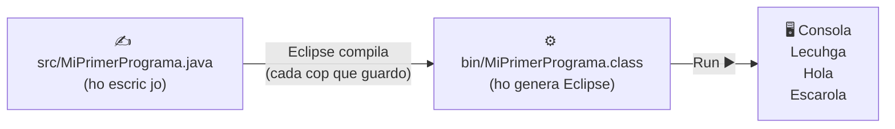

# 📚 Programació — CP 2026

El meu projecte d'Eclipse del curs. Cada classe `.java` té al costat **el seu apunt `.md` amb el mateix nom**: quan vas a buscar la classe, hi trobes l'explicació. Els apunts fan servir exactament els mateixos exemples, línies i comentaris que hi ha al codi.

## 🗺️ Índex (en ordre de classe)

| # | Classe | Apunt | Tema |
|---|--------|-------|------|
| 1 | `EstaClaseEsMuyImportante` | [EstaClaseEsMuyImportante.md](src/EstaClaseEsMuyImportante.md) | L'esquelet de tot programa: `class`, `main`, `{ }`, `;` |
| 2 | `MiPrimerPrograma` | [MiPrimerPrograma.md](src/MiPrimerPrograma.md) | `println`, comentaris `//`, ordre seqüencial |
| 3 | `ProblemasIntroJoel.HelloWorld` | [HelloWorld.md](src/ProblemasIntroJoel/HelloWorld.md) | Hello World, `package`, el `TODO` d'Eclipse |
| 4 | `Variables` | [Variables.md](src/Variables.md) | Què és una variable, tipus, `"a"` vs `a` |
| 5 | `VariablesInt` | [VariablesInt.md](src/VariablesInt.md) | Assignar, operar, acumular, prioritat `*` / `+` |
| 6 | `VariablesString` | [VariablesString.md](src/VariablesString.md) | Text i concatenació amb `+` |
| 7 | `elScanner.TuAmigoElScanner` | [TuAmigoElScanner.md](src/elScanner/TuAmigoElScanner.md) | Llegir del teclat: `nextInt`, `nextDouble`, `nextLine` |
| 8 | `ProblemasIntroJoel.PaAmbTomaquet` | [PaAmbTomaquet.md](src/ProblemasIntroJoel/PaAmbTomaquet.md) | Exercici: declarar → llegir → muntar → escriure |

### Llegenda dels apunts

> [!NOTE]
> Informació addicional o detall que convé saber.

> [!TIP]
> Truc o consell pràctic.

> [!WARNING]
> Error típic. Compte!

### Chuleta ràpida

```java
public class NomClasse {                      // la classe es diu igual que el fitxer
    public static void main(String[] args) {  // aquí comença el programa
        System.out.println("text");           // imprimeix i salta de línia
        int a = 0;                            // número enter
        double d = 2.5;                       // número amb decimals
        String s = "hola";                    // text (entre cometes)
        boolean b = true;                     // true / false
    }
}
```

---

# Estructura del projecte, Eclipse i Git

## 🗂️ Què hi ha dins la carpeta del projecte

```
CP-2026/
├── README.md             ← aquest fitxer (índex + com funciona el projecte)
├── .gitignore            ← diu a Git quins fitxers NO ha de guardar
├── .project              ← fitxer d'Eclipse (configuració del projecte)
├── .classpath            ← fitxer d'Eclipse (on és el codi, quina versió de Java)
├── .settings/            ← més configuració d'Eclipse
├── src/                  ← 💡 EL MEU CODI (.java) + els apunts (.md)
│   ├── MiPrimerPrograma.java
│   ├── MiPrimerPrograma.md        ← apunt de la classe del costat
│   ├── Variables.java
│   ├── Variables.md
│   ├── ...
│   ├── elScanner/                 ← un "package" (carpeta)
│   │   ├── TuAmigoElScanner.java
│   │   └── TuAmigoElScanner.md
│   └── ProblemasIntroJoel/        ← un altre "package"
│       ├── HelloWorld.java
│       ├── HelloWorld.md
│       ├── PaAmbTomaquet.java
│       └── PaAmbTomaquet.md
└── bin/                  ← ⚙️ CODI COMPILAT (.class) → el genera Eclipse sol
```

> [!NOTE]
> Els fitxers que comencen amb punt (`.project`, `.classpath`, `.gitignore`...) són fitxers "ocults". No els toques a mà: els gestiona Eclipse (o Git).

> [!TIP]
> A Eclipse, fes doble clic a un `.md` del Package Explorer per obrir-lo. Si et surt com a text pla, clic dret → **Open With → Generic Text Editor** o obre'l des de GitHub / VS Code per veure'l "bonic" (taules, diagrames...).

## ⚙️ `src` vs `bin`: de `.java` a `.class`

Jo escric codi que entén una persona (`.java`). L'ordinador no l'executa directament: primer s'ha de **compilar** (traduir) a un format que entén Java (`.class`).



- Cada vegada que guardo (`Ctrl + S`), Eclipse torna a compilar i reescriu els `.class`.
- Per tant, els `.class` **no cal guardar-los a Git**: es poden tornar a generar sempre.

## 📦 Els packages (carpetes dins de `src`)

Quan una classe està dins d'una carpeta de `src`, la primera línia del fitxer ha de dir en quina carpeta (package) és:

```java
package ProblemasIntroJoel;
```

```java
package elScanner;
```

| Fitxer | Primera línia |
|--------|---------------|
| `src/MiPrimerPrograma.java` | *(cap, està directament a `src`)* — és el "default package" |
| `src/elScanner/TuAmigoElScanner.java` | `package elScanner;` |
| `src/ProblemasIntroJoel/HelloWorld.java` | `package ProblemasIntroJoel;` |

> [!WARNING]
> Si el nom del `package` no coincideix amb el nom de la carpeta, Eclipse marca error en vermell.

## 🙈 El `.gitignore`

El fitxer `.gitignore` (a l'arrel del projecte) conté:

```gitignore
# Fitxers compilats per Eclipse (.class): es regeneren sols, no es pugen
bin/
```

- Cada línia és un patró de fitxers/carpetes que Git **ignorarà**.
- `bin/` → ignora tota la carpeta `bin` i el que hi hagi a dins.
- Les línies que comencen amb `#` són comentaris (com el `//` de Java).

> [!NOTE]
> El `.gitignore` només afecta fitxers que Git **encara no seguia**. Com que abans ja s'havien pujat alguns `.class`, s'han hagut de treure del seguiment amb:
>
> ```bash
> git rm -r --cached bin
> ```
>
> `--cached` vol dir "treu-ho de Git però **no ho esborris del disc**". La carpeta `bin` continua existint al meu ordinador; simplement Git ja no la mira.

## 📝 Commits amb missatges que s'entenguin

Un commit és una "foto" del projecte en un moment. El missatge serveix per saber què vaig canviar.

| ❌ Malament | ✅ Bé |
|------------|------|
| `a` | `Primer programa amb println` |
| `aaa` | `Exemples de variables int` |
| `aa` | `Exercici PaAmbTomaquet amb Scanner` |

D'aquí a un mes, "aaa" no em dirà res. "Exercici PaAmbTomaquet amb Scanner", sí.
