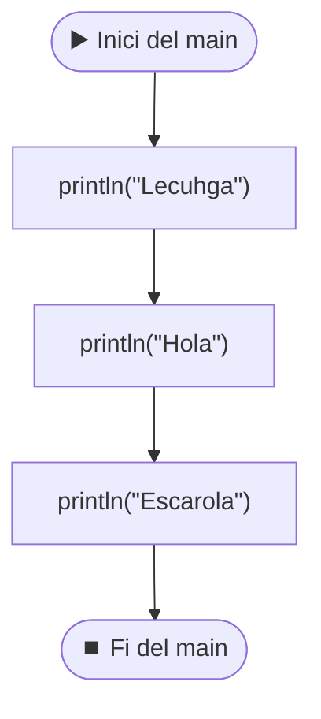

# 01 · El primer programa: `main`, `println` i comentaris

[⬅️ Anterior](00-estructura-projecte.md) · [Índex](README.md) · [Següent ➡️](02-variables.md)

Fitxers: `src/MiPrimerPrograma.java`, `src/EstaClaseEsMuyImportante.java`, `src/ProblemasIntroJoel/HelloWorld.java`

---

## 🧱 El programa més petit possible

```java
public class EstaClaseEsMuyImportante {
	
	public static void main(String[] args) {
		System.out.println("si");
	}

}
```

**Sortida per consola:**

```
si
```

Aquest és l'"esquelet" que **tots** els programes tindran. Peça a peça:

| Tros de codi | Què vol dir |
|--------------|-------------|
| `public class EstaClaseEsMuyImportante` | Creo una **classe** que es diu `EstaClaseEsMuyImportante`. El nom ha de ser **exactament igual** que el del fitxer (`EstaClaseEsMuyImportante.java`), majúscules incloses. |
| `{` ... `}` (les de fora) | Tot el que hi ha entre aquestes claus és "dins de la classe". |
| `public static void main(String[] args)` | El **main**: el punt on comença el programa. Quan premo Run ▶️, Java busca aquesta línia i comença a executar per aquí. De moment és una fórmula que s'escriu sempre igual. |
| `{` ... `}` (les de dins) | Tot el que hi ha entre aquestes claus és el que fa el programa. |
| `System.out.println("si");` | Imprimeix `si` per la consola. |
| `;` | Cada **instrucció** acaba amb punt i coma. És com el punt final d'una frase. |

> [!TIP]
> A Eclipse, escriu `main` + `Ctrl + Espai` i t'escriu sol el `public static void main(String[] args)`. Escriu `syso` + `Ctrl + Espai` i t'escriu `System.out.println();`.

### Les claus `{ }` són com capses una dins l'altra

```
┌─ public class EstaClaseEsMuyImportante { ───────────────┐
│                                                         │
│   ┌─ public static void main(String[] args) { ───────┐  │
│   │                                                  │  │
│   │      System.out.println("si");                   │  │
│   │                                                  │  │
│   └─ } ──────────────────────────────────────────────┘  │
│                                                         │
└─ } ─────────────────────────────────────────────────────┘
```

> [!WARNING]
> Cada `{` ha de tenir la seva `}`. Si en falta una, Eclipse marca error. Per això es fa servir el **sagnat** (tabulació): perquè es vegi a simple vista què està dins de què.

---

## 💬 Comentaris i ordre d'execució

```java
public class MiPrimerPrograma {

	//esto es un comentario.
	//los comentarios no influyen en el codigo, solo se ponen para que los lea un humano
	//ESTO ESTA FUERA DEL PROGRAMA
	public static void main(String[] args) {//cada bloque viene marcado por llaves

		System.out.println("Lecuhga");
		//println (o syso para los amigos), imprime por pantalla
		System.out.println("Hola");
		
		
		System.out.println("Escarola");
		//el orden es secuencial, escribe "Lechuga", "Hola", "Escarola"
	}//fin de las llaves
	//ESTO ESTA FUERA DEL PROGRAMA

}
```

**Sortida per consola:**

```
Lecuhga
Hola
Escarola
```

### 1. Comentaris `//`

```java
	//esto es un comentario.
	//los comentarios no influyen en el codigo, solo se ponen para que los lea un humano
```

- Tot el que hi ha **després de `//` fins al final de la línia** Java ho ignora.
- Serveixen per explicar el codi a una persona (a mi mateix d'aquí a una setmana, o al profe).
- Poden anar en una línia sola o al final d'una línia amb codi:

```java
	public static void main(String[] args) {//cada bloque viene marcado por llaves
```

Aquí el `public static void main(String[] args) {` sí que és codi; el `//cada bloque viene marcado por llaves` no.

### 2. Dins i fora del programa

```java
	//ESTO ESTA FUERA DEL PROGRAMA
	public static void main(String[] args) {
		...
	}//fin de las llaves
	//ESTO ESTA FUERA DEL PROGRAMA
```

El programa és **només el que hi ha entre les claus del `main`**. Les línies de fora del `main` no s'executen (en aquest cas, a més, són comentaris).

### 3. `println` imprimeix exactament el que hi ha entre cometes

```java
		System.out.println("Lecuhga");
		//println (o syso para los amigos), imprime por pantalla
```

- `System.out.println(...)` → escriu a la consola el que hi posis dins dels parèntesis i després **salta de línia** (`ln` = *line*).
- `"syso"` és el truc d'Eclipse per escriure-ho ràpid.

> [!WARNING]
> Fixa't: al codi posa `"Lecuhga"` (amb les lletres canviades) i el comentari diu `"Lechuga"`. Java **no corregeix res**: imprimeix lletra per lletra el que hi ha entre cometes. Per tant la sortida és `Lecuhga`, no `Lechuga`.

### 4. L'ordre és seqüencial (de dalt a baix)

```java
		//el orden es secuencial, escribe "Lechuga", "Hola", "Escarola"
```



- Java executa les instruccions **una darrere l'altra**, en l'ordre en què estan escrites.
- Les **línies en blanc** no fan res. Entre `"Hola"` i `"Escarola"` hi ha dues línies buides al codi, però a la consola surten seguides igualment.

---

## 🌍 Hello World

```java
package ProblemasIntroJoel;

public class HelloWorld {

	public static void main(String[] args) {
		// TODO Auto-generated method stub
		
		//System.out.println(lo que quieras imprimir);
		System.out.println("Hello World");
		
		
	}

}
```

**Sortida per consola:**

```
Hello World
```

- `package ProblemasIntroJoel;` → aquesta classe està dins la carpeta `src/ProblemasIntroJoel/` (mira l'[apunt 00](00-estructura-projecte.md#-els-packages-carpetes-dins-de-src)).
- `// TODO Auto-generated method stub` → és un comentari que **Eclipse posa sol** quan crees la classe marcant la casella del `main`. `TODO` vol dir "per fer". Es pot esborrar.
- `//System.out.println(lo que quieras imprimir);` → la "plantilla" de com s'usa el `println`. Com que té `//` davant, és un comentari i no s'executa.

> [!TIP]
> "Comentar" una línia de codi (posar-li `//` davant) és una manera de desactivar-la sense esborrar-la. A Eclipse: `Ctrl + 7` (o `Ctrl + /`) comenta/descomenta la línia on estàs.

---

## ✅ Resum

- Tot programa: `public class Nom { public static void main(String[] args) { ... } }`
- El nom de la classe = nom del fitxer.
- `System.out.println("...");` imprimeix i salta de línia.
- Cada instrucció acaba amb `;`.
- `//` = comentari, Java l'ignora.
- S'executa de dalt a baix, en ordre.
