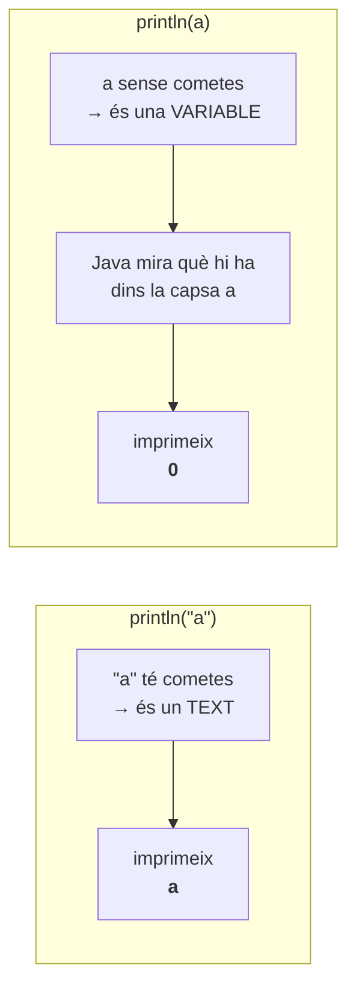

# 02 · Què és una variable i quins tipus hi ha

[⬅️ Anterior](01-primer-programa.md) · [Índex](README.md) · [Següent ➡️](03-variables-int.md)

Fitxer: `src/Variables.java`

---

## El codi

```java
public class Variables {
	
	public static void main(String[] args) {
		
		//variable
		//una variable es un valor que pot variar
		
		System.out.println("Cosa");
		
		
		//Una variable per fer-se servir s'ha de declarar
		// TIPUS NOM_VARIABLE = VALOR_INICIAL
		
		
		//TIPUS
		{
			//int: numeros enters (sense decimals)
			//double: numeros amb decimals
			//String: text (fixeu-vos que String comença amb majus)
			//el text esta sempre entre cometes ""
			//boolean: Si/No (concretament, true/false)
		
		}
		
		int a = 0;
		
		System.out.println("a"); //aixo imprimeix la lletra a
		System.out.println(a);//aixo imprimeix 0 
		
	}

}
```

**Sortida per consola:**

```
Cosa
a
0
```

---

## 📦 Què és una variable

```java
		//variable
		//una variable es un valor que pot variar
```

Imagina una **capsa amb una etiqueta**:

```
        etiqueta (NOM)
            │
            ▼
         ┌─────┐
    int  │  a  │      ← només hi caben números enters (TIPUS)
         ├─────┤
         │  0  │      ← el que hi ha a dins (VALOR)
         └─────┘
```

- La capsa té un **nom** (`a`) per poder-la fer servir després.
- La capsa té un **tipus** (`int`): diu quina mena de coses hi caben.
- La capsa té un **valor** a dins (`0`), que **pot canviar** durant el programa (per això es diu *variable*).

---

## ✍️ Com es declara una variable

```java
		//Una variable per fer-se servir s'ha de declarar
		// TIPUS NOM_VARIABLE = VALOR_INICIAL
```

```java
		int a = 0;
```

| `int` | `a` | `=` | `0` | `;` |
|:----:|:---:|:---:|:---:|:---:|
| TIPUS | NOM_VARIABLE | "guarda-hi" | VALOR_INICIAL | fi d'instrucció |

> [!NOTE]
> El `=` de Java **no** és el "igual" de mates. Vol dir **"guarda el valor de la dreta dins la variable de l'esquerra"**. Es llegeix: *"a val 0"* o *"a rep 0"*.

> [!WARNING]
> Una variable **s'ha de declarar abans de fer-la servir**. Si escrius `System.out.println(a);` abans de la línia `int a = 0;`, Eclipse dona error: no sap què és `a`.

---

## 🏷️ Els tipus bàsics

```java
		//TIPUS
		{
			//int: numeros enters (sense decimals)
			//double: numeros amb decimals
			//String: text (fixeu-vos que String comença amb majus)
			//el text esta sempre entre cometes ""
			//boolean: Si/No (concretament, true/false)
		
		}
```

| Tipus | Què guarda | Exemples de valors | Exemple de declaració |
|-------|-----------|--------------------|-----------------------|
| `int` | Números **enters** (sense decimals) | `0`, `10`, `-3`, `2026` | `int a = 0;` |
| `double` | Números **amb decimals** | `2.5`, `-0.75`, `3.0` | `double d = 2.5;` |
| `String` | **Text** (sempre entre cometes `""`) | `"hola"`, `"cosa"`, `""` | `String s = "hola";` |
| `boolean` | **Sí / No** → `true` / `false` | `true`, `false` | `boolean b = true;` |

> [!WARNING]
> - `String` va amb **S majúscula**. `string` (minúscula) dona error.
> - `int`, `double` i `boolean` van en **minúscula**.
> - Al codi, els decimals es posen amb **punt**: `2.5`, no `2,5`.

> [!NOTE]
> Les claus `{ }` que envolten els comentaris de `//TIPUS` creen un "bloc" buit. No fan res (a dins només hi ha comentaris); aquí només serveixen per agrupar visualment l'explicació.

---

## 🔍 `"a"` (amb cometes) vs `a` (sense cometes)

Aquesta és **la part més important** de l'arxiu:

```java
		System.out.println("a"); //aixo imprimeix la lletra a
		System.out.println(a);//aixo imprimeix 0 
```



| Codi | Java ho entén com... | Imprimeix |
|------|----------------------|-----------|
| `System.out.println("a");` | el **text** literal `a` | `a` |
| `System.out.println(a);` | el **valor de la variable** `a` | `0` |

Regla d'or: **amb cometes = text tal qual. Sense cometes = nom d'alguna cosa** (una variable).

---

## ✅ Resum

- Una variable és una capsa amb **tipus**, **nom** i **valor**.
- Es declara així: `TIPUS NOM_VARIABLE = VALOR_INICIAL;`
- Tipus: `int` (enters), `double` (decimals), `String` (text), `boolean` (true/false).
- `"a"` és text; `a` és una variable.
