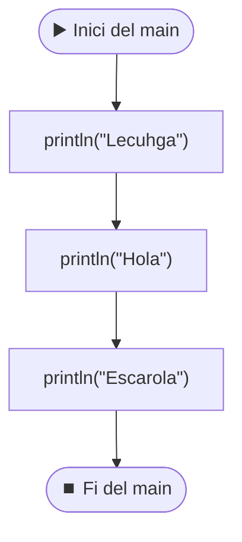

# MiPrimerPrograma — `println`, comentaris i ordre d'execució

[🏠 Índex](../README.md) · [⬅️ Anterior](EstaClaseEsMuyImportante.md) · [Següent ➡️](ProblemasIntroJoel/HelloWorld.md)

Fitxer: `src/MiPrimerPrograma.java`

> [!NOTE]
> L'estructura `public class` + `main` + `{ }` està explicada a [EstaClaseEsMuyImportante.md](EstaClaseEsMuyImportante.md).

---

## El codi

```java
public class MiPrimerPrograma {

	//esto es un comentario.
	//los comentarios no influyen en el codigo, solo se ponen para que los lea un humano
	//ESTO ESTA FUERA DEL PROGRAMA
	public static void main(String[] args) {//cada bloque viene marcado por llaves

		System.out.println("Lecuhga");
		//println (o syso para los amigos), imprime por pantalla
		System.out.println("Hola");
		
		
		System.out.println("Escarola");
		//el orden es secuencial, escribe "Lechuga", "Hola", "Escarola"
	}//fin de las llaves
	//ESTO ESTA FUERA DEL PROGRAMA

}
```

**Sortida per consola:**

```
Lecuhga
Hola
Escarola
```

---

## 1. Comentaris `//`

```java
	//esto es un comentario.
	//los comentarios no influyen en el codigo, solo se ponen para que los lea un humano
```

- Tot el que hi ha **després de `//` fins al final de la línia** Java ho ignora.
- Serveixen per explicar el codi a una persona (a mi mateix d'aquí a una setmana, o al profe).
- Poden anar en una línia sola o al final d'una línia amb codi:

```java
	public static void main(String[] args) {//cada bloque viene marcado por llaves
```

Aquí el `public static void main(String[] args) {` sí que és codi; el `//cada bloque viene marcado por llaves` no.

> [!TIP]
> "Comentar" una línia de codi (posar-li `//` davant) és una manera de desactivar-la sense esborrar-la. A Eclipse: `Ctrl + 7` (o `Ctrl + /`) comenta/descomenta la línia on estàs.

## 2. Dins i fora del programa

```java
	//ESTO ESTA FUERA DEL PROGRAMA
	public static void main(String[] args) {
		...
	}//fin de las llaves
	//ESTO ESTA FUERA DEL PROGRAMA
```

El programa és **només el que hi ha entre les claus del `main`**. Les línies de fora del `main` no s'executen (en aquest cas, a més, són comentaris).

## 3. `println` imprimeix exactament el que hi ha entre cometes

```java
		System.out.println("Lecuhga");
		//println (o syso para los amigos), imprime por pantalla
```

- `System.out.println(...)` → escriu a la consola el que hi posis dins dels parèntesis i després **salta de línia** (`ln` = *line*).
- `syso` és el truc d'Eclipse per escriure-ho ràpid (`syso` + `Ctrl + Espai`).

> [!WARNING]
> Fixa't: al codi posa `"Lecuhga"` (amb les lletres canviades) i el comentari diu `"Lechuga"`. Java **no corregeix res**: imprimeix lletra per lletra el que hi ha entre cometes. Per tant la sortida és `Lecuhga`, no `Lechuga`.

## 4. L'ordre és seqüencial (de dalt a baix)

```java
		//el orden es secuencial, escribe "Lechuga", "Hola", "Escarola"
```



- Java executa les instruccions **una darrere l'altra**, en l'ordre en què estan escrites.
- Les **línies en blanc** no fan res. Entre `"Hola"` i `"Escarola"` hi ha dues línies buides al codi, però a la consola surten seguides igualment.

---

## ✅ Resum

- `System.out.println("...");` imprimeix el text tal qual i salta de línia.
- `//` = comentari, Java l'ignora.
- Només s'executa el que hi ha dins del `main`.
- S'executa de dalt a baix, en ordre. Les línies en blanc no compten.
