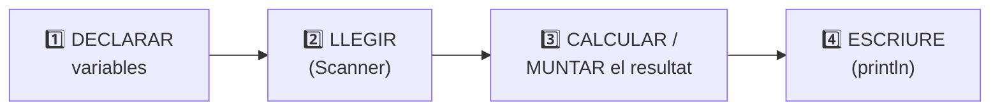

# PaAmbTomaquet — Exercici: pa amb tomàquet 🍅🍞

[🏠 Índex](../../README.md) · [⬅️ Anterior](../elScanner/TuAmigoElScanner.md) · [Següent ➡️](../alternativesifs/ElTeuAmicIf.md)

Fitxer: `src/ProblemasIntroJoel/PaAmbTomaquet.java`

---

## 🎯 Què ha de fer

Llegir **dues paraules** per teclat i escriure-les unides per `" amb "`.

| Entrada (el que escric) | Sortida |
|-------------------------|---------|
| `pa`<br/>`tomaquet` | `pa amb tomaquet` |
| `cafe`<br/>`llet` | `cafe amb llet` |

---

## El codi

```java
package ProblemasIntroJoel;

import java.util.Scanner;

public class PaAmbTomaquet {
	
	public static void main(String[] args) {
		
		String palabra1;
		String palabra2;
		
		Scanner sc = new Scanner(System.in);
		
		palabra1 = sc.nextLine();
		palabra2 = sc.nextLine();

		System.out.println(palabra1 +" amb "+palabra2);
		
	}

}
```

**Exemple d'execució:**

```
pa               ← jo escric això + Enter
tomaquet         ← jo escric això + Enter
pa amb tomaquet  ← ho imprimeix el programa
```

---

## 🧩 L'estructura de (gairebé) tots els exercicis



Aquest exercici segueix exactament aquest esquema.

---

## 1️⃣ Declarar sense valor inicial

```java
		String palabra1;
		String palabra2;
```

Fins ara sempre declaràvem amb valor (`String s = "hola";`). Aquí **només es crea la capsa, buida**:

```
           ┌────────────┐          ┌────────────┐
   String  │  palabra1  │  String  │  palabra2  │
           ├────────────┤          ├────────────┤
           │     ?      │          │     ?      │   ← encara sense valor
           └────────────┘          └────────────┘
```

És vàlid perquè **li donarem valor més tard**, quan l'usuari escrigui.

> [!WARNING]
> Una variable sense valor **no es pot fer servir** (ni imprimir ni operar) fins que no li'n donis un. Si fas `System.out.println(palabra1);` abans del `sc.nextLine()`, Eclipse dona error: *"The local variable palabra1 may not have been initialized"*.

> [!NOTE]
> També es podria haver escrit tot en una línia: `String palabra1 = sc.nextLine();` (com a `TuAmigoElScanner`). Les dues maneres fan el mateix.

---

## 2️⃣ Llegir

```java
		Scanner sc = new Scanner(System.in);
		
		palabra1 = sc.nextLine();
		palabra2 = sc.nextLine();
```

- Es crea l'Scanner (recorda l'`import java.util.Scanner;` de dalt!).
- `palabra1 = sc.nextLine();` → espera que escrigui una línia i la guarda a `palabra1`.
- **Sense `String` davant**, perquè la variable ja estava declarada (com `a = 10;` a [VariablesInt](../VariablesInt.md)).

> [!NOTE]
> Aquí **no cal** el `sc.nextLine();` solt: només llegim línies de text, no hi ha cap `nextInt`/`nextDouble` abans que deixi un `Enter` pendent.

---

## 3️⃣ i 4️⃣ Muntar el resultat i escriure'l

```java
		System.out.println(palabra1 +" amb "+palabra2);
```

```
   palabra1   +   " amb "   +   palabra2
      │              │              │
    "pa"     +   " amb "    +  "tomaquet"
      └──────────────┴──────────────┘
                 "pa amb tomaquet"
```

- `palabra1` i `palabra2` → **variables** (sense cometes): s'imprimeix el que l'usuari ha escrit.
- `" amb "` → **text** fix (amb cometes). Fixa't que porta **un espai abans i un després** de `amb`; si no, sortiria `paambtomaquet`.

---

## ✅ Resum

- Esquema: **declarar → llegir → muntar → escriure**.
- Es pot declarar una variable sense valor (`String palabra1;`) i donar-li'l després.
- Quan li dones valor després, **no** tornes a posar el tipus.
- Els espais que vols veure a la sortida han d'anar **dins** les cometes.
