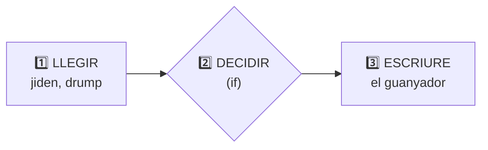
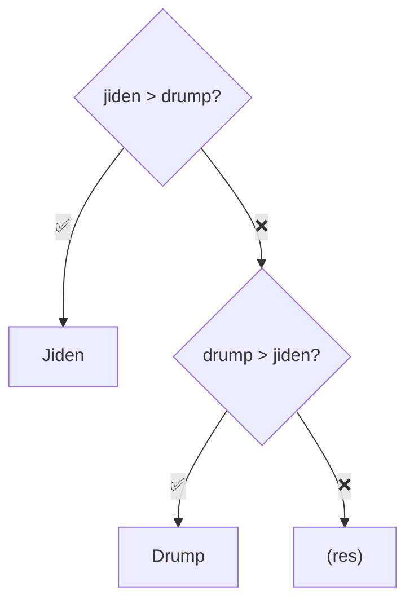

# Eleccions2020 — Exercici: qui guanya? (versió 1)

[🏠 Índex](../../README.md) · [⬅️ Anterior](../alternativesifs/operadoresLogicos.md) · [Següent ➡️](Eleccions20202.md)

Fitxer: `src/ProblemasJOEL/Eleccions2020.java`

---

## 🎯 Què ha de fer

Llegir els vots de dos candidats (**Jiden** i **Drump**) i escriure el nom del que en té més.

---

## El codi

```java
package ProblemasJOEL;

import java.util.Scanner;

public class Eleccions2020 {
	
	public static void main(String[] args) {
		
		
		//COM ES L'ENTRADA
		Scanner sc = new Scanner(System.in);
		
		int jiden = sc.nextInt();
		int drump = sc.nextInt();
				
		//COM FUNCIONA L'IF I LA SORTIDA
		if(jiden>drump) {
			System.out.println("Jiden");
		}else if(drump>jiden) {
			System.out.println("Drump");
		}
		
		
	}

}
```

**Exemples d'execució:**

| Entrada (el que escric) | Sortida |
|-------------------------|---------|
| `10 5` | `Jiden` |
| `5 10` | `Drump` |
| `7 7` | *(no imprimeix res)* |

---

## 🧩 L'esquema de sempre

Com a [PaAmbTomaquet](../ProblemasIntroJoel/PaAmbTomaquet.md), però ara amb una **decisió** al mig:



Els comentaris del codi separen justament aquestes parts: `//COM ES L'ENTRADA` i `//COM FUNCIONA L'IF I LA SORTIDA`.

---

## 1️⃣ L'entrada

```java
		//COM ES L'ENTRADA
		Scanner sc = new Scanner(System.in);
		
		int jiden = sc.nextInt();
		int drump = sc.nextInt();
```

- Es crea l'`Scanner` (amb l'`import java.util.Scanner;` a dalt) → mira [TuAmigoElScanner](../elScanner/TuAmigoElScanner.md).
- Es llegeixen **dos enters**: primer els vots de Jiden, després els de Drump. **L'ordre importa**: el primer número que escric va a `jiden`.

## 2️⃣ i 3️⃣ L'if i la sortida

```java
		//COM FUNCIONA L'IF I LA SORTIDA
		if(jiden>drump) {
			System.out.println("Jiden");
		}else if(drump>jiden) {
			System.out.println("Drump");
		}
```



| Entrada | `jiden>drump` | `drump>jiden` | Imprimeix |
|---------|:-------------:|:-------------:|-----------|
| `10 5` | `true` | *(no es mira)* | `Jiden` |
| `5 10` | `false` | `true` | `Drump` |
| `7 7` | `false` | `false` | *(res)* |

> [!WARNING]
> **Què passa si empaten?** Cap de les dues condicions és `true` i **no hi ha `else`**, per tant **no s'imprimeix res**. El programa acaba sense dir res.
> Això s'arregla a la versió següent → [Eleccions20202](Eleccions20202.md).

> [!NOTE]
> `"Jiden"` amb cometes és el **text** que s'imprimeix. `jiden` sense cometes és la **variable** amb els vots (mira [Variables](../Variables.md)). La majúscula també importa: per Java, `jiden` i `Jiden` són coses diferents.

---

## ✅ Resum

- Entrada → `if` → sortida.
- Amb `if` + `else if` i **sense `else`**, pot ser que no entri a cap bloc.
- Sempre pensa: **i si empaten?**
