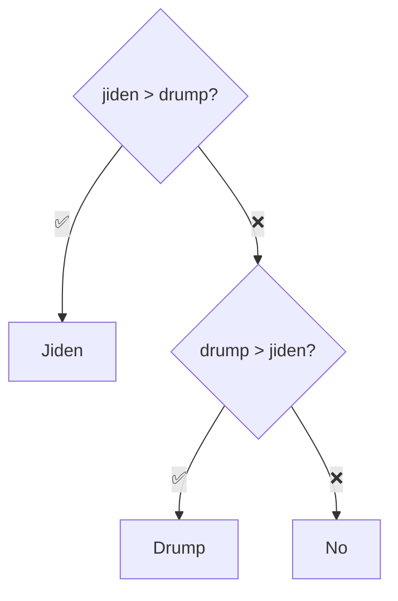

# Eleccions20202 — Exercici: qui guanya? (versió 2, amb empat)

[🏠 Índex](../../README.md) · [⬅️ Anterior](Eleccions2020.md) · [Següent ➡️](Eleccions20203.md)

Fitxer: `src/ProblemasJOEL/Eleccions20202.java`

> [!NOTE]
> És el mateix exercici que [Eleccions2020](Eleccions2020.md) però **arreglant l'empat**. Aquí només s'explica la diferència.

---

## El codi

```java
package ProblemasJOEL;

import java.util.Scanner;

public class Eleccions20202 {
	
	public static void main(String[] args) {
		
		
		//COM ES L'ENTRADA
		Scanner sc = new Scanner(System.in);
		
		int jiden = sc.nextInt();
		int drump = sc.nextInt();
				
		//COM FUNCIONA L'IF I LA SORTIDA
		if(jiden>drump) {
			System.out.println("Jiden");
		}else if(drump>jiden) {
			System.out.println("Drump");
		}else {
			System.out.println("No");
		}
		
		
	}

}
```

**Exemples d'execució:**

| Entrada (el que escric) | Sortida |
|-------------------------|---------|
| `10 5` | `Jiden` |
| `5 10` | `Drump` |
| `7 7` | `No` |

---

## 🆚 Què canvia respecte la versió 1

```diff
 		if(jiden>drump) {
 			System.out.println("Jiden");
 		}else if(drump>jiden) {
 			System.out.println("Drump");
+		}else {
+			System.out.println("No");
 		}
```

*(Les línies amb `+` són les noves.)*

S'ha afegit un **`else`** al final. L'`else` recull **tot el que no ha entrat** als blocs d'abans.



Si no és veritat que Jiden en té més, **ni** que Drump en té més... l'única possibilitat que queda és que **tinguin els mateixos vots**. No cal preguntar-ho (`jiden == drump`): l'`else` ja ho cobreix.

| Entrada | `jiden>drump` | `drump>jiden` | Bloc | Imprimeix |
|---------|:-------------:|:-------------:|------|-----------|
| `10 5` | `true` | — | `if` | `Jiden` |
| `5 10` | `false` | `true` | `else if` | `Drump` |
| `7 7` | `false` | `false` | `else` | `No` |

> [!TIP]
> Amb un `else` al final, el programa **sempre** imprimeix alguna cosa: és impossible que no entri a cap bloc. Per això és bona idea posar-lo quan l'exercici diu "si no, escriu...".

> [!NOTE]
> Fixa't que el nom de la classe és `Eleccions20202` (Eleccions2020 + **2** de versió 2). Cada classe ha de tenir un nom diferent dins del mateix package.

---

## ✅ Resum

- `else` final = "tots els altres casos".
- Amb `if` / `else if` / `else` sempre s'executa **exactament un** bloc.
- Aquí l'`else` captura l'empat sense haver de fer `jiden == drump`.
