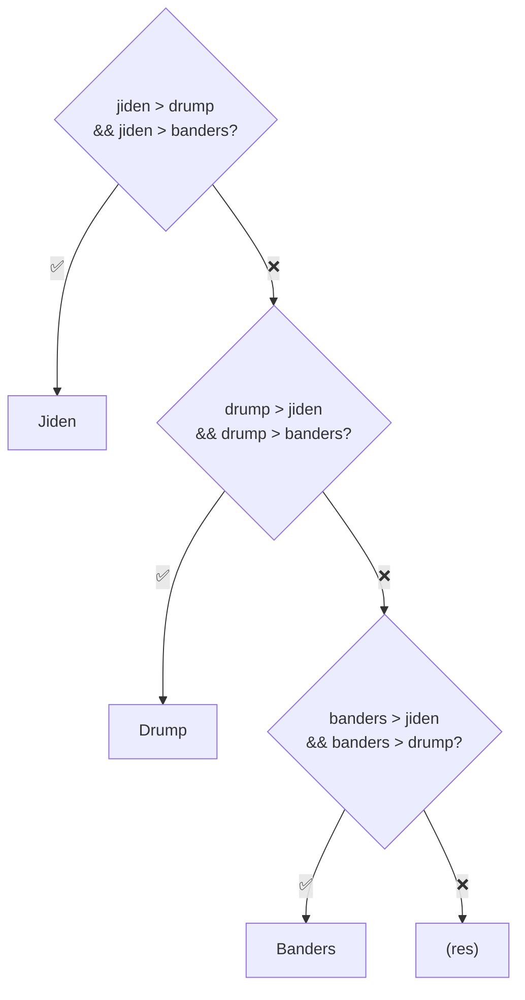

# Eleccions20203 — Exercici: qui guanya? (versió 3, tres candidats)

[🏠 Índex](../../README.md) · [⬅️ Anterior](Eleccions20202.md)

Fitxer: `src/ProblemasJOEL/Eleccions20203.java`

> [!NOTE]
> Continuació de [Eleccions2020](Eleccions2020.md) i [Eleccions20202](Eleccions20202.md). Ara hi ha **tres** candidats i cal fer servir l'`&&` de [operadoresLogicos](../alternativesifs/operadoresLogicos.md).

---

## El codi

```java
package ProblemasJOEL;

import java.util.Scanner;

public class Eleccions20203 {
	
	public static void main(String[] args) {
		
		
		//COM ES L'ENTRADA
		Scanner sc = new Scanner(System.in);
		
		int jiden = sc.nextInt();
		int drump = sc.nextInt();
		int banders = sc.nextInt();
				
		//COM FUNCIONA L'IF I LA SORTIDA
		if(jiden>drump && jiden>banders) {
			System.out.println("Jiden");
		}else if(drump>jiden && drump>banders) {
			System.out.println("Drump");
		}else if(banders>jiden && banders>drump) {
			System.out.println("Banders");
		}
		
		
	}

}
```

**Exemples d'execució:**

| Entrada (el que escric) | Sortida |
|-------------------------|---------|
| `10 5 3` | `Jiden` |
| `3 10 5` | `Drump` |
| `3 5 10` | `Banders` |
| `10 10 3` | *(no imprimeix res)* |
| `5 5 5` | *(no imprimeix res)* |

---

## 1️⃣ L'entrada: ara són tres

```java
		int jiden = sc.nextInt();
		int drump = sc.nextInt();
		int banders = sc.nextInt();
```

Igual que abans, però amb un tercer `nextInt()` per a `banders`. Ordre: **Jiden, Drump, Banders**.

---

## 2️⃣ Per què cal el `&&`

Amb dos candidats, n'hi havia prou amb una comparació (`jiden>drump`). Amb tres, per guanyar has de tenir més vots que **els dos altres alhora**:

> Jiden guanya si té més vots que Drump **I** més vots que Banders.

```java
		if(jiden>drump && jiden>banders) {
```

```
   jiden > drump    &&    jiden > banders
   └─────┬─────┘          └──────┬──────┘
  "guanya a Drump"   I   "guanya a Banders"
          └───────────┬──────────┘
           true NOMÉS si guanya als dos
```

> [!WARNING]
> Si només mirés `jiden>drump`, amb l'entrada `10 5 20` diria `Jiden`... però Banders en té 20! Per això cal comprovar **tots dos** rivals.

> [!WARNING]
> En Java **no** es pot escriure `jiden > drump && banders` ni `jiden > (drump, banders)`. Cada comparació s'escriu **sencera**: `jiden>drump && jiden>banders`.

---

## 3️⃣ L'estructura de l'if

| Bloc | Condició | Es llegeix |
|------|----------|-----------|
| `if` | `jiden>drump && jiden>banders` | Jiden guanya als altres dos |
| `else if` | `drump>jiden && drump>banders` | Drump guanya als altres dos |
| `else if` | `banders>jiden && banders>drump` | Banders guanya als altres dos |

Cada candidat té **la mateixa pregunta**, canviant qui és el protagonista.



### Traça amb `3 10 5`

| Condició | Càlcul | Resultat |
|----------|--------|:--------:|
| `jiden>drump && jiden>banders` | `3>10` (`false`) `&&` ... | `false` |
| `drump>jiden && drump>banders` | `10>3` (`true`) `&&` `10>5` (`true`) | **`true`** → `Drump` |
| `banders>...` | *(no es mira)* | — |

> [!NOTE]
> Al primer `if`, com que `3>10` ja és `false`, Java **ni tan sols mira** `jiden>banders`: amb un `false` en un `&&`, el resultat ja és `false` segur.

---

## ⚠️ I si hi ha empat?

| Entrada | Què passa |
|---------|-----------|
| `10 10 3` | Jiden **no** té més que Drump (10 > 10 és `false`) → no entra. Drump tampoc té més que Jiden → no entra. Banders no → no entra. **No imprimeix res.** |
| `5 5 5` | Ningú té més que els altres → **no imprimeix res.** |

Igual que a la [versió 1](Eleccions2020.md): sense `else` al final, si cap condició és `true` no surt res. Si l'enunciat demanés escriure alguna cosa en cas d'empat, s'hauria d'afegir:

```java
		}else {
			System.out.println("No");
		}
```

---

## ✅ Resum

- Per ser el **més gran de tres**, has de ser més gran que **cadascun** dels altres → `&&`.
- Cada comparació s'escriu sencera: `a>b && a>c`.
- Sense `else`, els empats no imprimeixen res.
