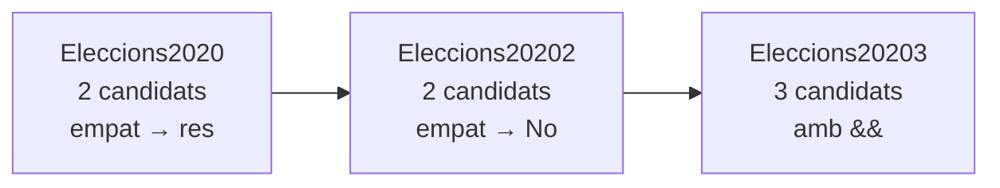

# 📦 `ProblemasJOEL` — Exercicis amb `if`

[🏠 Índex general](../../README.md) · [⬆️ src](../README.md)

Problemes per practicar les alternatives de [alternativesifs](../alternativesifs/README.md): llegir dades amb l'`Scanner` i decidir què s'escriu amb `if` / `else if` / `else`.

Les tres versions d'**Eleccions** són el mateix problema, cada cop una mica més complet:

## 📄 Apunts d'aquest paquet

| Classe | Apunt | De què va |
|--------|-------|-----------|
| `Eleccions2020` | [Eleccions2020.md](Eleccions2020.md) | Qui guanya entre Jiden i Drump (si empaten no surt res) |
| `Eleccions20202` | [Eleccions20202.md](Eleccions20202.md) | El mateix, amb `else` per a l'empat |
| `Eleccions20203` | [Eleccions20203.md](Eleccions20203.md) | Tres candidats: cal `&&` per guanyar als dos altres |

## 🗂️ Altres paquets

| Paquet | De què va |
|--------|-----------|
| [src (default package)](../README.md) | Fonaments: `main`, `println`, variables |
| [elScanner](../elScanner/README.md) | Llegir del teclat amb l'`Scanner` |
| [ProblemasIntroJoel](../ProblemasIntroJoel/README.md) | Primers exercicis: Hello World i Pa amb tomàquet |
| [alternativesifs](../alternativesifs/README.md) | `if`, `else if`, operadors lògics i el residu `%` |
