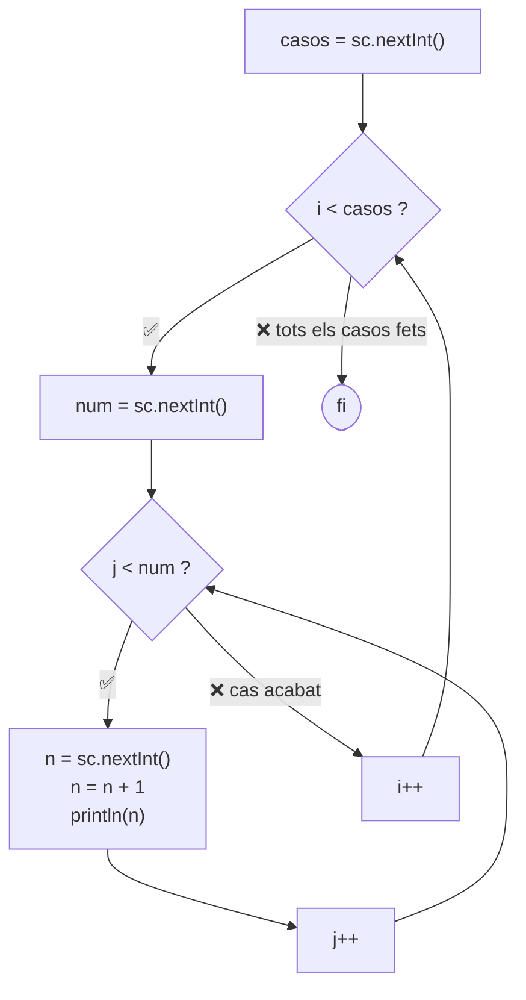

# segonDeBucles — Exercici: casos de prova i bucles niuats

[🏠 Índex](../../README.md) · [📦 Paquet](README.md) · [⬅️ Anterior](../introbucles/introduccioFor.md) · [Següent ➡️](../buclesAcumulador/ElAcumulador.md)

Fitxer: `src/ProblemasJOEL/segonDeBucles.java`

> [!NOTE]
> Fa servir el `for` de [introduccioFor](../introbucles/introduccioFor.md) i el `while` de [IntroduccioWhile](../introbucles/IntroduccioWhile.md). Aquí es posa **un bucle dins d'un altre**.

---

## 🎯 Què ha de fer

L'entrada té aquest format:

1. Un número **`casos`**: quants casos de prova hi ha.
2. Per a **cada cas**: un número **`N`** (quants números té aquest cas) i, després, **`N` números**.

Per a cada número llegit, s'ha d'escriure **aquest número + 1**.

Exemple d'entrada:

```
2          ← casos: n'hi ha 2
3          ← cas 1: té 3 números...
5 10 -1    ←   ...que són aquests
1          ← cas 2: té 1 número...
7          ←   ...que és aquest
```

Sortida:

```
6
11
0
8
```

> [!NOTE]
> El programa resol el problema **dues vegades**: primer amb `for` i després amb `while`. Per això, quan l'executes, has d'escriure l'entrada **dos cops** seguits. Les dues versions donen exactament la mateixa sortida.

---

## El codi

```java
package ProblemasJOEL;

import java.util.Scanner;

public class segonDeBucles {

	public static void main(String[] args) {
		Scanner sc = new Scanner(System.in);
		
		int casos;

		/*
		 * RESOLUCIÓ UTILITZANT BUCLES FOR
		 */
		
		casos = sc.nextInt();
		// BUCLE PRINCIPAL QUE CONTROLA ELS CASOS
		for (int i=0; i<casos; i++) {
			int num = sc.nextInt();
			
			// BUCLE INTERN QUE ES DEDICA A LLEGIR UN NUMERO I DONAR LA RESPOSTA
			for (int j=0; j<num; j++) {
				// FAIG EL TRACTAMENT DEL NUMERO
				int n = sc.nextInt();
				n = n + 1;
				System.out.println(n);				
			}			
		}
		
		/*
		 * RESOLUCIÓ UTILITZANT BUCLES WHILE
		 */
		
		casos = sc.nextInt();
		while (casos > 0) {

			// Resoldre un cas
			int N = sc.nextInt();
			while (N > 0) {
				int variable = sc.nextInt();
				variable++;
				System.out.println(variable);
				N--;
			}
			casos--;
		}
		
		sc.close();
	}
}
```

---

## 💬 Comentaris de diverses línies `/* ... */`

```java
		/*
		 * RESOLUCIÓ UTILITZANT BUCLES FOR
		 */
```

Fins ara només havíem vist `//`, que comenta **una línia**. Amb `/*` ... `*/` es comenta **tot el que hi ha entremig**, encara que ocupi moltes línies.

| Tipus | Comença | Acaba | Abast |
|-------|---------|-------|-------|
| De línia | `//` | al final de la línia | una línia |
| De bloc | `/*` | `*/` | totes les línies que hi hagi entremig |

> [!NOTE]
> Els `*` del mig (` * RESOLUCIÓ...`) són només decoració: Eclipse els posa sols perquè quedi bonic. El que compta és el `/*` del principi i el `*/` del final.

---

## 🪆 Bucles niuats: un bucle dins d'un altre

```java
		casos = sc.nextInt();
		// BUCLE PRINCIPAL QUE CONTROLA ELS CASOS
		for (int i=0; i<casos; i++) {
			int num = sc.nextInt();
			
			// BUCLE INTERN QUE ES DEDICA A LLEGIR UN NUMERO I DONAR LA RESPOSTA
			for (int j=0; j<num; j++) {
				// FAIG EL TRACTAMENT DEL NUMERO
				int n = sc.nextInt();
				n = n + 1;
				System.out.println(n);				
			}			
		}
```

Hi ha **dos nivells** de repetició:

| Bucle | Comptador | Quantes voltes | Què fa a cada volta |
|-------|:---------:|:--------------:|---------------------|
| **Principal** (de fora) | `i` | `casos` | Llegeix quants números té el cas (`num`) i executa el bucle intern sencer |
| **Intern** (de dins) | `j` | `num` | Llegeix **un** número, li suma 1 i l'imprimeix |



> [!IMPORTANT]
> Per **cada volta** del bucle de fora, el bucle de dins es fa **sencer**, des del principi (`j` torna a començar a 0).

### Per què `j` i no `i`?

El bucle intern és **dins** del de fora, i la `i` del de fora **encara existeix**. Si el de dins també es digués `i`, Eclipse donaria error (*"Duplicate local variable i"*). Per conveni, el segon comptador es diu **`j`** (i el tercer, `k`).

> [!NOTE]
> A [introduccioFor](../introbucles/introduccioFor.md) sí que podíem repetir `int i` perquè aquells `for` anaven **un darrere l'altre**, no un dins l'altre.

### Traça amb l'entrada d'exemple

| Llegeix | `i` | `j` | Què passa | Imprimeix |
|---------|:---:|:---:|-----------|:---------:|
| `casos = 2` | — | — | hi haurà 2 casos | |
| `num = 3` | 0 | — | el cas 1 té 3 números | |
| `n = 5` | 0 | 0 | 5 + 1 | `6` |
| `n = 10` | 0 | 1 | 10 + 1 | `11` |
| `n = -1` | 0 | 2 | -1 + 1 | `0` |
| | 0 | 3 | `3<3` és `false` → fi del cas 1 | |
| `num = 1` | 1 | — | el cas 2 té 1 número | |
| `n = 7` | 1 | 0 | 7 + 1 | `8` |
| | 1 | 1 | `1<1` és `false` → fi del cas 2 | |
| | 2 | — | `2<2` és `false` → **fi** | |

---

## 🔁 La mateixa solució amb `while`

```java
		casos = sc.nextInt();
		while (casos > 0) {

			// Resoldre un cas
			int N = sc.nextInt();
			while (N > 0) {
				int variable = sc.nextInt();
				variable++;
				System.out.println(variable);
				N--;
			}
			casos--;
		}
```

- `casos = sc.nextInt();` → **sense `int`**, perquè `casos` ja es va declarar a dalt (`int casos;`). Simplement es llegeix un valor nou.
- En lloc d'un comptador `i` que puja de 0 fins a `casos`, aquí **es fa baixar `casos` mateix** fins que arriba a 0:

| | Versió `for` | Versió `while` |
|---|---|---|
| Comptador de casos | `i` puja: 0, 1, 2... fins a `casos` | `casos` baixa: 2, 1, 0 |
| Condició de fora | `i<casos` | `casos > 0` |
| Comptador de números | `j` puja fins a `num` | `N` baixa fins a 0 |
| Sumar 1 | `n = n + 1;` | `variable++;` |

Totes dues fan **el mateix nombre de voltes**: si `casos` val 2, `i` val 0 i 1 (2 voltes), o bé `casos` val 2 i 1 (2 voltes).

> [!WARNING]
> El `N--;` i el `casos--;` són **imprescindibles**: són el que fa canviar la condició. Sense ells, `N > 0` sempre seria `true` → **bucle infinit**.
> Fixa't també **on** és cada un: `N--` va **dins** del bucle intern, i `casos--` va **fora** del bucle intern però dins del de fora.

> [!NOTE]
> Amb el `while` es "gasta" la variable: quan s'acaba, `casos` val 0 i ja no saps quants casos hi havia. Amb el `for` no: `casos` no canvia i el comptador és una altra variable (`i`).

> [!NOTE]
> `N` amb majúscula és un nom de variable vàlid, però per conveni les variables van en minúscula (`n`). Aquí es fa servir `N` perquè és com ho escriuen els enunciats dels problemes.

---

## ✅ Resum

- `/* ... */` → comentari de **diverses línies**.
- Bucles **niuats**: per cada volta del de fora, el de dins es fa **sencer**.
- El comptador del bucle de dins s'ha de dir diferent: `i` → `j` → `k`.
- Patró dels problemes amb casos: **llegir `casos`** → per cada cas, **llegir `N`** → **llegir `N` números**.
- `for` comptant cap amunt o `while` fent baixar la variable (`casos--`, `N--`): mateix resultat.
