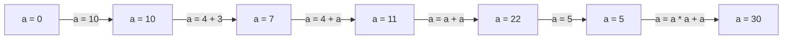

# VariablesInt — Assignar, operar i acumular

[🏠 Índex](../README.md) · [⬅️ Anterior](Variables.md) · [Següent ➡️](VariablesString.md)

Fitxer: `src/VariablesInt.java`

---

## El codi

```java
public class VariablesInt {
	
	public static void main(String[] args) {
		
		int a = 0;
		
		//nomes poses el tipus quan la declares, despres no poses mai el tipus
		a = 10;
		
		System.out.println("1.");
		System.out.println(a);
		System.out.println("-----------");
		
		a = 4 + 3;
		System.out.println("2.");	
		System.out.println(a);
		System.out.println("-----------");
		
		a = 4 + a; //las variables se pueden acumular
		System.out.println("3.");	
		System.out.println(a);
		System.out.println("-----------");
		
		a = a + a;
		System.out.println("4.");	
		System.out.println(a);
		System.out.println("-----------");
		
		a = 5;
		//(22 * 22) + 22
		a = a * a + a;
		System.out.println("5.");	
		System.out.println(a);
		System.out.println("-----------");
		
		//he hecho un cambio!
	}

}
```

**Sortida per consola:**

```
1.
10
-----------
2.
7
-----------
3.
11
-----------
4.
22
-----------
5.
30
-----------
```

---

## 🧠 La regla clau: com funciona el `=`

```
        a   =   4 + a ;
        ▲       ───┬───
        │          │
        │    1️⃣ PRIMER es calcula la dreta
        │       (amb el valor que té "a" ARA)
        │
   2️⃣ DESPRÉS el resultat es guarda a l'esquerra
      (i el valor antic de "a" es perd)
```

> [!IMPORTANT]
> Sempre: **primer es calcula tot el que hi ha a la dreta del `=`**, i **després** es guarda a la variable de l'esquerra. El valor anterior desapareix (la capsa només pot tenir un valor alhora).

---

## 🔁 Pas a pas (traça del programa)

Seguim el valor de la capsa `a` línia per línia:

| Línia de codi | Càlcul de la dreta | `a` abans | `a` després | Imprimeix |
|---------------|--------------------|:---------:|:-----------:|-----------|
| `int a = 0;` | `0` | *(no existeix)* | **0** | — |
| `a = 10;` | `10` | 0 | **10** | `1.` / `10` |
| `a = 4 + 3;` | `4 + 3 = 7` | 10 | **7** | `2.` / `7` |
| `a = 4 + a;` | `4 + 7 = 11` | 7 | **11** | `3.` / `11` |
| `a = a + a;` | `11 + 11 = 22` | 11 | **22** | `4.` / `22` |
| `a = 5;` | `5` | 22 | **5** | — |
| `a = a * a + a;` | `5 * 5 + 5 = 30` | 5 | **30** | `5.` / `30` |



---

## 1️⃣ Declarar vs assignar

```java
		int a = 0;
		
		//nomes poses el tipus quan la declares, despres no poses mai el tipus
		a = 10;
```

| | Codi | Què fa |
|---|------|--------|
| **Declarar** | `int a = 0;` | **Crea** la capsa `a` (de tipus `int`) i hi posa un `0`. Només es fa **una vegada**. |
| **Assignar** | `a = 10;` | La capsa `a` **ja existeix**: només en canvio el contingut. **Sense** `int` davant. |

> [!WARNING]
> Si escric `int a = 10;` un segon cop, Eclipse dona error: *"Duplicate local variable a"*. Estic intentant crear una capsa que ja existeix.

---

## 2️⃣ Es poden fer operacions

```java
		a = 4 + 3;
```

Java calcula `4 + 3` → `7` i ho guarda a `a`. A la variable s'hi guarda el **resultat**, no l'operació.

Operadors amb `int`:

| Operador | Significat | Exemple | Resultat |
|:--------:|-----------|---------|:--------:|
| `+` | suma | `4 + 3` | `7` |
| `-` | resta | `4 - 3` | `1` |
| `*` | multiplicació | `4 * 3` | `12` |
| `/` | divisió **entera** | `7 / 2` | `3` ⚠️ |
| `%` | residu de la divisió | `7 % 2` | `1` |

> [!WARNING]
> Entre dos `int`, la divisió **talla els decimals**: `7 / 2` dona `3`, no `3.5`. Un `int` no pot tenir decimals.

---

## 3️⃣ Les variables es poden acumular

```java
		a = 4 + a; //las variables se pueden acumular
```

En mates `a = 4 + a` no té sentit. En Java sí, perquè el `=` vol dir "guarda":

1. Què val `a` ara? → `7`
2. Calculo la dreta: `4 + 7` → `11`
3. Guardo `11` a `a`.

És a dir: **"a la `a` li sumo 4"**. La variable fa servir el seu propi valor antic per calcular el nou.

---

## 4️⃣ La variable pot sortir diverses vegades

```java
		a = a + a;
```

`a` val `11` → `11 + 11` → `22`. Totes les `a` de la dreta valen el mateix (el valor d'abans de guardar).

---

## 5️⃣ Prioritat: `*` abans que `+`

```java
		a = 5;
		//(22 * 22) + 22
		a = a * a + a;
```

- Primer `a = 5;` → la capsa passa de `22` a `5`.
- Després `a * a + a` amb `a = 5`:

```
   a * a + a
   5 * 5 + 5
   ─────
    25   + 5
   ─────────
       30
```

Com a mates: **primer es fan les multiplicacions (i divisions), després les sumes (i restes)**. És a dir, `a * a + a` és `(a * a) + a`.

> [!NOTE]
> El comentari `//(22 * 22) + 22` explica com s'agrupa l'operació. Però com que just abans hi ha `a = 5;`, en aquest moment `a` **no val 22 sinó 5**. El resultat real és `(5 * 5) + 5 = 30`.
> Si traguéssim la línia `a = 5;`, llavors sí: `(22 * 22) + 22 = 506`.

> [!TIP]
> Si vols canviar l'ordre, fes servir parèntesis: `a * (a + a)` amb `a = 5` → `5 * 10` → `50`.

---

## 6️⃣ Imprimir separadors per llegir millor la sortida

```java
		System.out.println("1.");
		System.out.println(a);
		System.out.println("-----------");
```

- `"1."` i `"-----------"` porten cometes → són **text** i s'imprimeixen tal qual.
- `a` no porta cometes → s'imprimeix el **valor** de la variable.

Això fa que la consola quedi ordenada i se sàpiga quin número correspon a cada pas.

---

## ✅ Resum

- `int` només s'escriu en declarar la variable. Després, només `a = ...;`
- El `=` primer calcula la dreta i després guarda a l'esquerra.
- `a = 4 + a;` → acumula (fa servir el valor vell per calcular el nou).
- `*` i `/` van abans que `+` i `-`.
- Entre `int`, `/` talla decimals.
