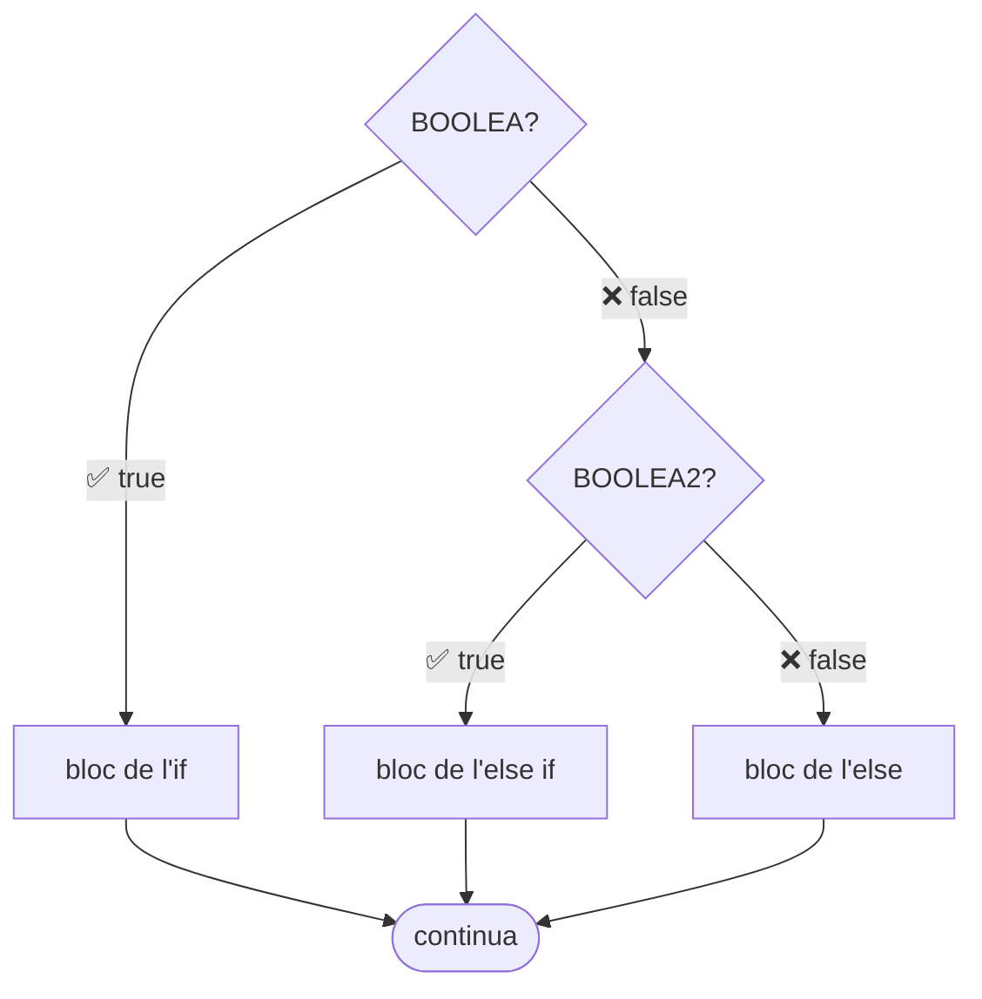

# ElTeuAmicElseIf — L'`else if`: més de dos camins

[🏠 Índex](../../README.md) · [⬅️ Anterior](ElTeuAmicIf.md) · [Següent ➡️](operadoresLogicos.md)

Fitxer: `src/alternativesifs/ElTeuAmicElseIf.java`

> [!NOTE]
> L'`if` / `else` bàsic està explicat a [ElTeuAmicIf.md](ElTeuAmicIf.md).

---

## El codi

```java
package alternativesifs;

public class ElTeuAmicElseIf {
	
	public static void main(String[] args) {
		
		
		//if
		
		//if(BOOLEA){
			//cosa que passa si la condicio es TRUE
			//mes coses que passen si la condicio es TRUE
			//encara mes coses
		//}else if(BOOLEA2){
			//cosa que passa si BOOLEA es FALSE i BOOLEA2 ES TRUE
			//només si es compleixen les dues coses
		//}else{
			//coses que passen si la condicio es FALSE
			//mes coses que passen si la condicio es FALSE
			// etc
		//}
		
		boolean b = true;
		
		int a = 4;
		int c = 3;
		
		if(a>c) {
			System.out.println("A");
		}else if(c>a){
			System.out.println("C");
		}else {
			System.out.println("IGUALES");
		}
		
		
		
		
		int q = 11;
		int t = 20;
		
		if(q>10) {
			System.out.println("Q MAYOR 10");
		}else if(t>10) {
			System.out.println("T MAYOR 10");
		}else {
			System.out.println("NINGUNO MAYOR 10");
		}
		
		
	}

}
```

**Sortida per consola:**

```
A
Q MAYOR 10
```

---

## 🧩 L'estructura

```java
		//if(BOOLEA){
			//...
		//}else if(BOOLEA2){
			//cosa que passa si BOOLEA es FALSE i BOOLEA2 ES TRUE
			//només si es compleixen les dues coses
		//}else{
			//...
		//}
```

L'`else if` vol dir **"si no, però si..."**. Afegeix una pregunta nova que **només es mira si l'anterior ha donat `false`**.



| Bloc | Quan s'executa |
|------|----------------|
| `if(BOOLEA)` | `BOOLEA` és `true` |
| `else if(BOOLEA2)` | `BOOLEA` és `false` **i** `BOOLEA2` és `true` ("només si es compleixen les dues coses") |
| `else` | `BOOLEA` és `false` **i** `BOOLEA2` és `false` (cap de les anteriors) |

> [!TIP]
> Pots posar **tants `else if` com vulguis** un darrere l'altre. I l'`else` final és opcional.

> [!IMPORTANT]
> Java mira les condicions **de dalt a baix** i fa **només el PRIMER bloc que sigui `true`**. Un cop n'ha fet un, **se salta tota la resta** (encara que també fossin `true`).

---

## 🔍 Exemple 1: més gran, més petit o igual

```java
		int a = 4;
		int c = 3;
		
		if(a>c) {
			System.out.println("A");
		}else if(c>a){
			System.out.println("C");
		}else {
			System.out.println("IGUALES");
		}
```

1. `a>c` → `4 > 3` → **`true`** → imprimeix `A`.
2. Com que ja ha entrat en un bloc, **ni mira** el `c>a` ni l'`else`.

Taula amb altres valors:

| `a` | `c` | `a>c` | `c>a` | Imprimeix |
|:---:|:---:|:-----:|:-----:|:---------:|
| 4 | 3 | `true` | *(no es mira)* | `A` |
| 3 | 4 | `false` | `true` | `C` |
| 5 | 5 | `false` | `false` | `IGUALES` |

Aquest és l'arreglo del problema de [ElTeuAmicIf](ElTeuAmicIf.md): ara els empats tenen el seu propi cas.

---

## 🔍 Exemple 2: compte, només entra al primer!

```java
		int q = 11;
		int t = 20;
		
		if(q>10) {
			System.out.println("Q MAYOR 10");
		}else if(t>10) {
			System.out.println("T MAYOR 10");
		}else {
			System.out.println("NINGUNO MAYOR 10");
		}
```

1. `q>10` → `11 > 10` → **`true`** → imprimeix `Q MAYOR 10`.
2. **Fi.** No mira el `t>10`.

> [!WARNING]
> `t` val `20`, per tant `t>10` **també és `true`**... però **`T MAYOR 10` no surt mai** amb aquests valors. Amb `else if`, com a màxim s'executa **un** bloc: el primer que es compleix.

| `q` | `t` | `q>10` | `t>10` | Imprimeix |
|:---:|:---:|:------:|:------:|-----------|
| 11 | 20 | `true` | *(no es mira)* | `Q MAYOR 10` |
| 5 | 20 | `false` | `true` | `T MAYOR 10` |
| 5 | 3 | `false` | `false` | `NINGUNO MAYOR 10` |

### `else if` vs dos `if` separats

Si volgués que sortissin **les dues** frases, hauria de fer dos `if` **independents** (sense `else`):

```java
if(q>10) {
	System.out.println("Q MAYOR 10");
}
if(t>10) {
	System.out.println("T MAYOR 10");
}
```

```
Q MAYOR 10
T MAYOR 10
```

| | `if ... else if ...` | `if ...` + `if ...` |
|---|---|---|
| Quants blocs pot fer | **Com a màxim un** | Tots els que es compleixin |
| Quan s'usa | Opcions que s'exclouen entre elles | Preguntes que no tenen res a veure |

---

## ✅ Resum

- `if(...) { } else if(...) { } else { }`
- Es mira de dalt a baix; s'executa **només el primer** bloc que és `true`.
- L'`else` final recull tots els casos que no han entrat enlloc.
- Si vols que es puguin complir diverses coses alhora → `if` separats.
