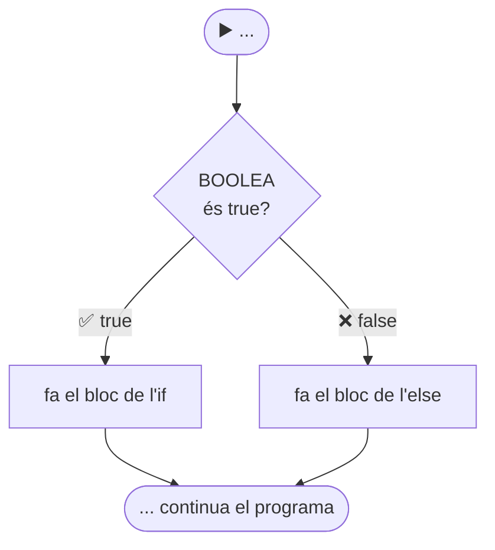

# ElTeuAmicIf — L'`if` / `else`: decidir entre dos camins

[🏠 Índex](../../README.md) · [⬅️ Anterior](../ProblemasIntroJoel/PaAmbTomaquet.md) · [Següent ➡️](ElTeuAmicElseIf.md)

Fitxer: `src/alternativesifs/ElTeuAmicIf.java`

---

## El codi

```java
package alternativesifs;

public class ElTeuAmicIf {
	
	public static void main(String[] args) {
		
		
		//if
		
		//if(BOOLEA){
			//cosa que passa si la condicio es TRUE
			//mes coses que passen si la condicio es TRUE
			//encara mes coses
		//}else{
			//coses que passen si la condicio es FALSE
			//mes coses que passen si la condicio es FALSE
			// etc
		//}
		
		boolean b = true;
		
		int a = 5;
		int c = 5;
		
		if(a>c) {
			System.out.println("A");
		}else {
			System.out.println("C");
		}
		
		
		
	}

}
```

**Sortida per consola:**

```
C
```

---

## 🤔 Per a què serveix

Fins ara, els programes feien **sempre totes les línies**, de dalt a baix ([MiPrimerPrograma](../MiPrimerPrograma.md)).

Amb l'`if` el programa pot **triar**: fer una cosa o una altra segons una condició. És com una cruïlla:



> [!IMPORTANT]
> **Sempre s'executa UN dels dos blocs, mai els dos i mai cap.** O el de l'`if`, o el de l'`else`.

---

## 🧩 L'estructura (la plantilla dels comentaris)

```java
		//if(BOOLEA){
			//cosa que passa si la condicio es TRUE
			//mes coses que passen si la condicio es TRUE
			//encara mes coses
		//}else{
			//coses que passen si la condicio es FALSE
			//mes coses que passen si la condicio es FALSE
			// etc
		//}
```

| Tros | Què vol dir |
|------|-------------|
| `if` | "si" |
| `(BOOLEA)` | La **condició**, sempre entre **parèntesis**. Ha de ser una cosa que doni `true` o `false` (un `boolean`, mira [Variables](../Variables.md)). |
| `{ ... }` després de l'`if` | Les línies que es fan **si la condició és `true`**. Poden ser tantes com vulguis. |
| `else` | "si no" / "en cas contrari" |
| `{ ... }` després de l'`else` | Les línies que es fan **si la condició és `false`**. |

> [!WARNING]
> - **No** es posa `;` després de `if(...)` ni després de `else`. Les claus `{ }` ja marquen on comença i on acaba.
> - L'`else` **no porta condició**: és "tota la resta de casos".
> - L'`else` és **opcional**. Si no el poses i la condició és `false`, simplement no es fa res i el programa continua.

---

## 🔍 Pas a pas amb l'exemple

```java
		int a = 5;
		int c = 5;
		
		if(a>c) {
			System.out.println("A");
		}else {
			System.out.println("C");
		}
```

1. `a` val `5`, `c` val `5`.
2. Condició: `a>c` → `5 > 5` → **`false`** (5 no és *més gran* que 5, és igual).
3. Com que és `false`, salta el bloc de l'`if` i fa el de l'`else`.
4. Imprimeix **`C`**.

| `a` | `c` | `a>c` | Imprimeix |
|:---:|:---:|:-----:|:---------:|
| 5 | 5 | `false` | `C` |
| 7 | 5 | `true` | `A` |
| 3 | 5 | `false` | `C` |

> [!NOTE]
> Fixa't que quan són **iguals** (`5` i `5`) també imprimeix `C`, com si `c` fos més gran. L'`else` agafa **tot** el que no compleix la condició, inclosos els empats. Per distingir 3 casos (més gran / més petit / igual) cal l'`else if` → [ElTeuAmicElseIf](ElTeuAmicElseIf.md).

> [!NOTE]
> La línia `boolean b = true;` crea una variable que **no es fa servir enlloc**. No fa cap mal; Eclipse simplement la subratlla en groc (*"The value of the local variable b is not used"*). Si volguéssim, podríem fer `if(b) { ... }`, perquè `b` ja és un `boolean`.

---

## ✅ Resum

- `if(condició) { ... } else { ... }`
- La condició va entre parèntesis i ha de donar `true` o `false`.
- `true` → bloc de l'`if`. `false` → bloc de l'`else`. **Només un dels dos.**
- Sense `;` després de l'`if(...)`.
