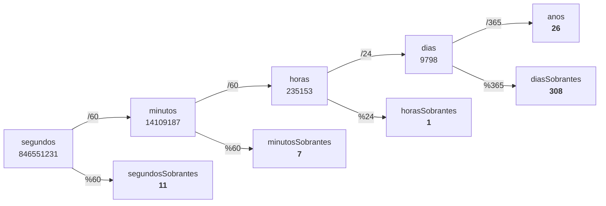

# modulos — La divisió entera, el residu `%` i per a què serveix

[🏠 Índex](../../README.md) · [📦 Paquet](README.md) · [⬅️ Anterior](../ProblemasJOEL/Eleccions20203.md)

Fitxer: `src/alternativesifs/modulos.java`

---

## El codi

```java
package alternativesifs;

public class modulos {
	
	public static void main(String[] args) {
		
		int a = 10;
		int b = 2;
		
		System.out.println(a/b); //el resultado de la division, quociente, divisor, dividendo
		System.out.println(a%b); //el residuo
		
		
		//PARA QUE SIRVE EL RESIDUO?
		
		
		int par = 233281903;
		
		if(par%2==0) {
			System.out.println(par+" ES PAR");
		}else {
			System.out.println(par+ " ES IMPAR");
		}
		
		
		//pero no te lo haria con decimales?
		
		System.out.println("---Pero no te lo haria con decimales?");
		double entero = 5.0/2;
		System.out.println(entero);
		
		//en una division si el numerador y el denominador (el de arriba y el de abajo) son enteros, la division es entera y sale recortada. RECORDATADA, NO REDONEADA
		//si uno de los dos (o los dos) son dobles (decimales) entonces el resultado es doble (decimal)
		
		//VALE PERO PARA QUE MAS SIRVE EL RESIDUO
		
		long segundos = 846551231;
		
		long minutos = segundos/60;
		long segundosSobrantes = segundos%60;
		
		long horas = minutos/60;
		long minutosSobrantes = minutos%60;
		
		
		System.out.println(segundos + " segundos equivalen a "+horas+ " horas " + minutosSobrantes + " minutos "+segundosSobrantes+ " segundos");
		long dias = horas / 24;
		long horasSobrantes = horas % 24;
		
		long anos = dias / 365;
		long diasSobrantes = dias % 365;
		System.out.println(segundos + " segundos equivalen a "+anos+ " años "+diasSobrantes+" dias "+ horasSobrantes+ " horas " + minutosSobrantes + " minutos "+segundosSobrantes+ " segundos");
		
		
		
	}

}
```

**Sortida per consola:**

```
5
0
233281903 ES IMPAR
---Pero no te lo haria con decimales?
2.5
846551231 segundos equivalen a 235153 horas 7 minutos 11 segundos
846551231 segundos equivalen a 26 años 308 dias 1 horas 7 minutos 11 segundos
```

---

## ➗ 1. Divisió `/` i residu `%`

```java
		int a = 10;
		int b = 2;
		
		System.out.println(a/b); //el resultado de la division, quociente, divisor, dividendo
		System.out.println(a%b); //el residuo
```

Recorda la divisió "de l'escola", la de la caseta:

```
   dividend → 10 │ 2  ← divisor
              ───┼───
    residu →   0 │ 5  ← quocient
```

| Nom | Què és | A l'exemple | En Java |
|-----|--------|:-----------:|---------|
| **Dividend** | el número que divideixo | `10` | `a` |
| **Divisor** | entre quant divideixo | `2` | `b` |
| **Quocient** | quantes vegades hi cap | `5` | `a/b` |
| **Residu** | el que **sobra** | `0` | `a%b` |

- `a/b` → `10 / 2` → **`5`**
- `a%b` → el que sobra de repartir 10 entre 2 → **`0`** (és exacta, no sobra res)

> [!NOTE]
> El `%` **no té res a veure amb els percentatges**. En Java, `%` vol dir "**el residu** de la divisió". Es diu *mòdul* (d'aquí el nom de la classe `modulos`).

Més exemples per entendre-ho:

| Operació | Quocient `/` | Residu `%` | Per què |
|----------|:-----------:|:---------:|---------|
| `10` entre `2` | `10/2` = **5** | `10%2` = **0** | 2 × 5 = 10, no sobra res |
| `7` entre `2` | `7/2` = **3** | `7%2` = **1** | 2 × 3 = 6, sobra 1 |
| `17` entre `5` | `17/5` = **3** | `17%5` = **2** | 5 × 3 = 15, sobra 2 |
| `3` entre `5` | `3/5` = **0** | `3%5` = **3** | 5 no hi cap cap vegada, sobra tot |

> [!TIP]
> Sempre es compleix: **dividend = divisor × quocient + residu**. Ex: `17 = 5 × 3 + 2`.

---

## 🔢 2. Per a què serveix el residu? Parells i senars

```java
		//PARA QUE SIRVE EL RESIDUO?
		
		
		int par = 233281903;
		
		if(par%2==0) {
			System.out.println(par+" ES PAR");
		}else {
			System.out.println(par+ " ES IMPAR");
		}
```

Un número és **parell** si, en dividir-lo entre 2, **no sobra res**. Per tant:

| Si... | Vol dir que és... |
|-------|-------------------|
| `num % 2 == 0` | **parell** (*par*) |
| `num % 2 == 1` (o `!= 0`) | **senar** (*impar*) |

Amb `par = 233281903`:

```
   par % 2 == 0
   233281903 % 2  == 0
         1        == 0
            false   →  else  →  "233281903 ES IMPAR"
```

- Primer es calcula `par%2` (operador aritmètic → un **número**: `1`).
- Després `1 == 0` (operador lògic → un **boolean**: `false`). Mira [operadoresLogicos](operadoresLogicos.md).
- `false` → entra a l'`else`.

> [!NOTE]
> Fixa't que el nom de la variable és `par`, però el número que conté és **senar**. El nom d'una variable no canvia el que hi ha a dins: Java només mira el valor.

> [!TIP]
> El mateix truc serveix per saber si un número és **múltiple** d'un altre: `num % 3 == 0` → és múltiple de 3. `num % 10` → et dona l'**última xifra** (`233281903 % 10` → `3`).

---

## ✂️ 3. "Pero no te lo haria con decimales?"

```java
		System.out.println("---Pero no te lo haria con decimales?");
		double entero = 5.0/2;
		System.out.println(entero);
		
		//en una division si el numerador y el denominador (el de arriba y el de abajo) son enteros, la division es entera y sale recortada. RECORDATADA, NO REDONEADA
		//si uno de los dos (o los dos) son dobles (decimales) entonces el resultado es doble (decimal)
```

La regla dels comentaris, en una taula:

| Numerador | Denominador | Tipus de divisió | Exemple | Resultat |
|-----------|-------------|------------------|---------|:--------:|
| `int` | `int` | **entera** (talla decimals) | `5/2` | `2` |
| `double` | `int` | decimal | `5.0/2` | `2.5` |
| `int` | `double` | decimal | `5/2.0` | `2.5` |
| `double` | `double` | decimal | `5.0/2.0` | `2.5` |

- `5.0` porta `.0` → és un `double`. Per tant `5.0/2` és una divisió amb decimals → **`2.5`**.
- Si hagués escrit `5/2` (els dos enters), el resultat seria **`2`**.

### Retallada, no arrodonida

| Operació | Resultat exacte | Arrodonit seria | Java (`int/int`) dona |
|----------|:---------------:|:---------------:|:---------------------:|
| `5/2` | 2.5 | 3 | **`2`** |
| `19/10` | 1.9 | 2 | **`1`** |
| `9/10` | 0.9 | 1 | **`0`** |

La divisió entera **llença tot el que hi ha darrere la coma**, encara que sigui `.9`. No arrodoneix mai.

> [!WARNING]
> **Compte amb aquest parany:** `double d = 5/2;` dona **`2.0`**, no `2.5`! Java primer fa `5/2` (dos `int` → `2`) i **després** el guarda al `double` → `2.0`. El que decideix el tipus de divisió són els números de la **dreta**, no la variable de l'esquerra.

> [!NOTE]
> La variable es diu `entero` però és un `double` i conté `2.5`. Igual que amb `par`: el nom no importa, el que compta és el tipus i el valor.

---

## ⏱️ 4. "Vale pero para que mas sirve el residuo": convertir segons

```java
		//VALE PERO PARA QUE MAS SIRVE EL RESIDUO
		
		long segundos = 846551231;
```

### Un tipus nou: `long`

| Tipus | Què guarda | Fins a quant (aprox.) |
|-------|-----------|-----------------------|
| `int` | enters | ±2.147.483.647 (uns 2 mil milions) |
| `long` | enters **molt grans** | ±9.223.372.036.854.775.807 (9 trilions) |

`long` és com un `int`, però amb una capsa més gran. Es fa servir igual: `/`, `%`, `+`... `846551231` encara cabria en un `int`, però amb `long` ens curem en salut si el número creix.

### La idea: `/` dona les unitats grans, `%` el que sobra

Per passar segons a minuts: 60 segons = 1 minut.
- `segundos / 60` → quants minuts **sencers** hi caben.
- `segundos % 60` → quants segons **sobren** (que no arriben a fer un minut).

I es repeteix l'esquema a cada pas, amb la unitat següent:



### Pas a pas

| Línia de codi | Càlcul | Valor |
|---------------|--------|------:|
| `long minutos = segundos/60;` | 846551231 / 60 | **14109187** |
| `long segundosSobrantes = segundos%60;` | 846551231 % 60 | **11** |
| `long horas = minutos/60;` | 14109187 / 60 | **235153** |
| `long minutosSobrantes = minutos%60;` | 14109187 % 60 | **7** |
| `long dias = horas / 24;` | 235153 / 24 | **9798** |
| `long horasSobrantes = horas % 24;` | 235153 % 24 | **1** |
| `long anos = dias / 365;` | 9798 / 365 | **26** |
| `long diasSobrantes = dias % 365;` | 9798 % 365 | **308** |

> [!TIP]
> Comprovació d'un pas: `14109187 × 60 = 846551220`, i `846551220 + 11 = 846551231`. ✅ Quadra amb *dividend = divisor × quocient + residu*.

### Les dues sortides

```java
		System.out.println(segundos + " segundos equivalen a "+horas+ " horas " + minutosSobrantes + " minutos "+segundosSobrantes+ " segundos");
```

```
846551231 segundos equivalen a 235153 horas 7 minutos 11 segundos
```

Aquí fa servir `horas` (**totes** les hores, 235153), perquè encara no ha passat a dies.

```java
		System.out.println(segundos + " segundos equivalen a "+anos+ " años "+diasSobrantes+" dias "+ horasSobrantes+ " horas " + minutosSobrantes + " minutos "+segundosSobrantes+ " segundos");
```

```
846551231 segundos equivalen a 26 años 308 dias 1 horas 7 minutos 11 segundos
```

Aquí ja fa servir `horasSobrantes` (1), perquè les altres hores ja estan comptades dins dels dies i els anys.

> [!WARNING]
> Fixa't en quina variable va a cada lloc: si a la segona frase posés `horas` en comptes de `horasSobrantes`, sortiria "26 años 308 dias **235153** horas", comptant les hores dues vegades.

> [!NOTE]
> Les dues frases són concatenacions de text i números (mira [VariablesString](../VariablesString.md)). Els espais dins de `" horas "`, `" minutos "`... són els que separen els números de les paraules.
> La variable es diu `anos` (sense `ñ`) però el text imprimeix `" años "`: dins de les cometes la `ñ` no dona cap problema.

---

## ✅ Resum

- `/` → quocient. `%` → **residu** (el que sobra). El `%` no és un percentatge.
- `num % 2 == 0` → parell.
- `int / int` → divisió **entera, retallada** (no arrodonida). Si algun és `double` → resultat amb decimals.
- `double d = 5/2;` → `2.0` (compte!).
- `long` = `int` per a números molt grans.
- Convertir unitats: `/` per les unitats grans, `%` pel que sobra, i repetir.
