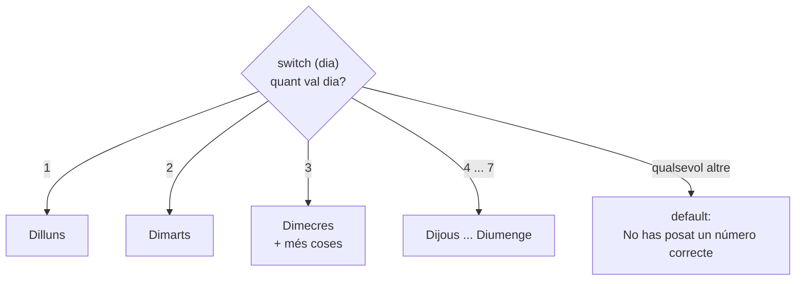
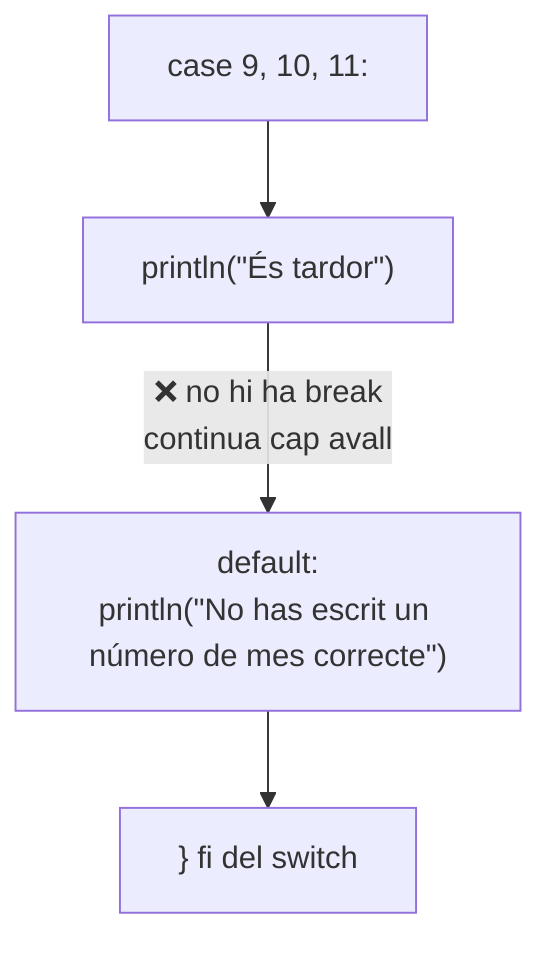

# exempleNum — El `switch` amb números

[🏠 Índex](../../README.md) · [📦 Paquet](README.md) · [⬅️ Anterior](../alternativesifs/modulos.md) · [Següent ➡️](exempleString.md)

Fitxer: `src/alternativesswitch/exempleNum.java`

---

## El codi

```java
package alternativesswitch;

import java.util.Scanner;

public class exempleNum {

	public static void main(String[] args) {
		Scanner sc = new Scanner(System.in);
		System.out.println("Escriu quin número de dia és:");
		int dia = sc.nextInt();
		int i = 0;

		switch (dia) {
			case 1:
				System.out.println("Dilluns");
				break;
			case 2:
				System.out.println("Dimarts");
				break;
			case 3:
				System.out.println("Dimecres");
				// Aquí podem fer moltes instruccions
				int numero = 54;
				i++;
				i = i + numero;
				System.out.println("La i val " + i);
				// Hem d'acabar cada "case" amb un break, obligatori.
				break;
			case 4:
				System.out.println("Dijous");
				break;
			case 5:
				System.out.println("Divendres");
				break;
			case 6:
				System.out.println("Dissabte");
				break;
			case 7:
				System.out.println("Diumenge");
				break;

			default:
				System.out.println("No has posat un número correcte");
				break;		
		}
		
		// Fem un exemple amb estacions de l'any:
		System.out.println("Escriu un número de mes");
		int mes = sc.nextInt();
		switch (mes) {
			case 12, 1, 2:
				System.out.println("És hivern");
			break;
			case 3, 4, 5:
				System.out.println("És primavera");
				break;
			case 6:
			case 7:
			case 8:
				System.out.println("És estiu");
				break;
			case 9, 10, 11:
				System.out.println("És tardor");
			
			default:
				System.out.println("No has escrit un número de mes correcte");
			
		}
		
		sc.close();
	}
}
```

**Exemples d'execució** (escric dos números: el dia i el mes):

| Entrada | Sortida |
|---------|---------|
| `1` `1` | `Dilluns` / `És hivern` |
| `3` `4` | `Dimecres` / `La i val 55` / `És primavera` |
| `8` `7` | `No has posat un número correcte` / `És estiu` |
| `5` `10` | `Divendres` / `És tardor` / `No has escrit un número de mes correcte` ⚠️ |
| `0` `13` | `No has posat un número correcte` / `No has escrit un número de mes correcte` |

*(Abans de cada número també surten les preguntes `Escriu quin número de dia és:` i `Escriu un número de mes`.)*

---

## 🤔 Per a què serveix

Imagina fer el primer exemple amb `if`:

```java
if(dia == 1) {
	System.out.println("Dilluns");
} else if(dia == 2) {
	System.out.println("Dimarts");
} else if(dia == 3) {
	...
} else {
	System.out.println("No has posat un número correcte");
}
```

Funciona, però és molt repetitiu: `dia == ...` set vegades. El **`switch`** fa el mateix d'una manera més clara quan **compares una sola variable amb molts valors concrets**.



---

## 🧩 L'estructura

```java
		switch (dia) {
			case 1:
				System.out.println("Dilluns");
				break;
			...
			default:
				System.out.println("No has posat un número correcte");
				break;		
		}
```

| Tros | Què vol dir |
|------|-------------|
| `switch (dia)` | "Mira quant val `dia`". Entre parèntesis va **la variable** (no una condició `true`/`false` com a l'`if`). |
| `{ ... }` | Tots els casos van dins d'aquestes claus. |
| `case 1:` | "Si val **1**, comença aquí". Porta **dos punts** `:`, no `;` ni claus. |
| `break;` | "**Surt del switch**". Sense ell, continua cap avall (mira més avall ⚠️). |
| `default:` | "Si no és cap dels anteriors". És com l'`else` final. És opcional. |

> [!NOTE]
> El `switch` només compara si **és igual** a un valor. No pots fer `case > 5:`. Per a rangs (`> 0 && < 100`) cal un `if` → mira [operadoresLogicos](../alternativesifs/operadoresLogicos.md).

> [!TIP]
> A Eclipse, escriu `switch` + `Ctrl + Espai` i t'escriu l'esquelet.

---

## 🔍 Pas a pas: el `case 3`

```java
			case 3:
				System.out.println("Dimecres");
				// Aquí podem fer moltes instruccions
				int numero = 54;
				i++;
				i = i + numero;
				System.out.println("La i val " + i);
				// Hem d'acabar cada "case" amb un break, obligatori.
				break;
```

Dins d'un `case` hi pots posar **tantes línies com vulguis**, fins al `break`. Sense claus.

| Línia | Què fa | `i` val |
|-------|--------|:-------:|
| `int i = 0;` *(abans del switch)* | crea `i` | **0** |
| `System.out.println("Dimecres");` | imprimeix `Dimecres` | 0 |
| `int numero = 54;` | crea `numero` amb 54 | 0 |
| `i++;` | **suma 1 a `i`** | **1** |
| `i = i + numero;` | `1 + 54` | **55** |
| `System.out.println("La i val " + i);` | imprimeix `La i val 55` | 55 |
| `break;` | surt del switch | — |

### Nou: `i++`

`i++` és una manera curta d'escriure **`i = i + 1;`** (sumar-li 1). S'utilitza moltíssim, sobretot als bucles ([IntroduccioWhile](../introbucles/IntroduccioWhile.md)).

| Curt | Equivalent llarg |
|------|------------------|
| `i++;` | `i = i + 1;` |
| `i--;` | `i = i - 1;` |

---

## ⚠️ El `break` i la "caiguda" (fall-through)

```java
				// Hem d'acabar cada "case" amb un break, obligatori.
```

Quan Java entra en un `case`, executa **cap avall** fins que troba un `break` (o el final del switch). **Els altres `case` no l'aturen.** Si oblides el `break`, "cau" al `case` de sota i també l'executa.

Això és exactament el que passa amb la tardor:

```java
			case 9, 10, 11:
				System.out.println("És tardor");
			
			default:
				System.out.println("No has escrit un número de mes correcte");
			
		}
```

Amb `mes = 10`:



```
Escriu un número de mes
10
És tardor
No has escrit un número de mes correcte
```

> [!WARNING]
> Aquí és un **error**: diu que és tardor *i* que el mes no és correcte. S'arregla afegint el `break` que falta:
>
> ```java
> 			case 9, 10, 11:
> 				System.out.println("És tardor");
> 				break;
> ```

> [!NOTE]
> Java **compila** igual sense `break` (Eclipse no marca error). Per això és fàcil oblidar-lo. "Obligatori" vol dir: obligatori si **no** vols que caigui al següent.
> Al `default`, com que és l'últim, el `break` no fa res, però posar-lo sempre és un bon costum.

---

## 🧺 Diversos valors al mateix `case`

Hi ha **dues maneres** de fer que diversos valors facin el mateix, i el codi fa servir totes dues:

### Manera 1: separats per comes

```java
			case 12, 1, 2:
				System.out.println("És hivern");
			break;
			case 3, 4, 5:
				System.out.println("És primavera");
				break;
```

`case 12, 1, 2:` → "si val 12, **o** 1, **o** 2". L'ordre no importa (el 12 pot anar primer).

### Manera 2: `case` buits un sota l'altre

```java
			case 6:
			case 7:
			case 8:
				System.out.println("És estiu");
				break;
```

Aquí s'aprofita la **caiguda a propòsit**: si `mes` val 6, entra al `case 6:`, que està buit i no té `break`, per tant cau al `case 7:`, també buit, cau al `case 8:` i imprimeix `És estiu`.

| | Comes `case 6, 7, 8:` | Apilats `case 6: case 7: case 8:` |
|---|---|---|
| Resultat | Idèntic | Idèntic |
| Versió de Java | Moderna (Java 14+) | Clàssica (sempre ha funcionat) |

> [!NOTE]
> Al `case 12, 1, 2:` el `break;` està menys sagnat que la resta. Això **no canvia res**: a Java el sagnat és només per llegir millor. Però és més clar posar-lo alineat amb el `println`.

---

## 🔒 `sc.close()`

```java
		sc.close();
```

"Tanca" l'Scanner quan ja no el necessites. Es posa al final. Si no el poses, Eclipse t'avisa en groc (*"Resource leak: 'sc' is never closed"*), però el programa funciona igual.

> [!WARNING]
> Un cop tancat, **ja no pots tornar a llegir** amb aquell Scanner. Posa'l només quan hagis acabat de llegir-ho tot.

---

## ✅ Resum

- `switch (variable) { case valor: ... break; default: ... }`
- Compara la variable amb **valors concrets** (només igualtat).
- **Sense `break` cau al següent `case`**: el mes 10 mostra l'error.
- Diversos valors: `case 12, 1, 2:` o `case 6: case 7: case 8:`.
- `default` = cap dels anteriors (com l'`else`).
- `i++` = `i = i + 1`.
