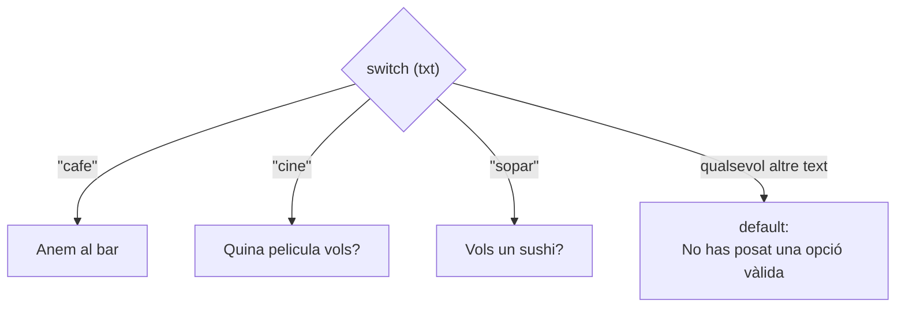

# exempleString — El `switch` amb text

[🏠 Índex](../../README.md) · [📦 Paquet](README.md) · [⬅️ Anterior](exempleNum.md) · [Següent ➡️](../introbucles/IntroduccioWhile.md)

Fitxer: `src/alternativesswitch/exempleString.java`

> [!NOTE]
> Com funciona el `switch`, el `break` i el `default` està explicat a [exempleNum](exempleNum.md). Aquí només s'explica què canvia quan és amb text.

---

## El codi

```java
package alternativesswitch;

import java.util.Scanner;

public class exempleString {

	public static void main(String[] args) {
		Scanner sc =new Scanner(System.in);
		System.out.println("Què vols fer? (cafe/cine/sopar)");
		String txt = sc.nextLine();
		
		switch (txt) {
		case "cafe":
			System.out.println("Anem al bar");
			break;
		case "cine":
			System.out.println("Quina pelicula vols?");
			break;
		case "sopar":
			System.out.println("Vols un sushi?");
			break;
		
		default:
			System.out.println("No has posat una opció vàlida");
		
		}
		sc.close();
	}

}
```

**Exemples d'execució:**

| Entrada (el que escric) | Sortida |
|-------------------------|---------|
| `cafe` | `Anem al bar` |
| `cine` | `Quina pelicula vols?` |
| `sopar` | `Vols un sushi?` |
| `Cafe` | `No has posat una opció vàlida` ⚠️ |
| `res` | `No has posat una opció vàlida` |

*(Abans surt sempre la pregunta `Què vols fer? (cafe/cine/sopar)`.)*

---

## 📝 1. Llegir el text

```java
		String txt = sc.nextLine();
```

Es llegeix **una línia sencera** i es guarda a `txt` (mira [TuAmigoElScanner](../elScanner/TuAmigoElScanner.md)).

## 🔀 2. El `switch` amb un `String`

```java
		switch (txt) {
		case "cafe":
			System.out.println("Anem al bar");
			break;
```

És igual que amb números, però els valors dels `case` són **textos** → **entre cometes**.

| Amb `int` ([exempleNum](exempleNum.md)) | Amb `String` (aquest) |
|------------------------------------------|----------------------|
| `switch (dia)` | `switch (txt)` |
| `case 1:` | `case "cafe":` |



> [!WARNING]
> El text ha de ser **exactament igual**, lletra per lletra:
> - **Majúscules**: `Cafe` ≠ `cafe` → va al `default`.
> - **Accents**: `cafè` ≠ `cafe`.
> - **Espais**: `cafe ` (amb un espai al final) ≠ `cafe`.

> [!WARNING]
> Sense cometes (`case cafe:`) Eclipse dona error: es pensaria que `cafe` és una variable.

### El `default` sense `break`

```java
		default:
			System.out.println("No has posat una opció vàlida");
		
		}
```

Aquí **no passa res** per no tenir `break`: com que el `default` és l'últim, no hi ha cap `case` a sota on pugui caure. Just després ve la `}` que tanca el switch.

> [!NOTE]
> A diferència de la tardor de [exempleNum](exempleNum.md), aquí no hi ha error perquè **cap** `case` es queda sense `break`, excepte l'últim.

---

## ✅ Resum

- El `switch` també funciona amb `String`: `case "text":`.
- El text ha de coincidir **exactament** (majúscules, accents i espais inclosos).
- Si l'últim és el `default`, el `break` no és necessari.
