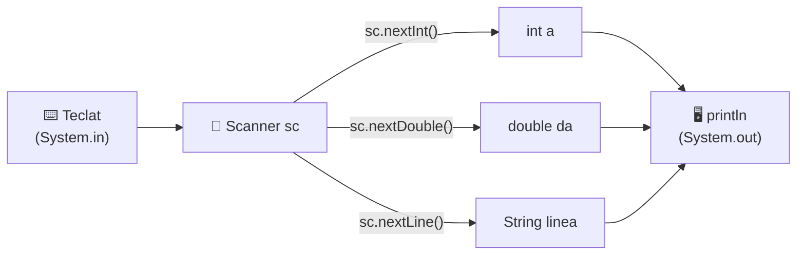
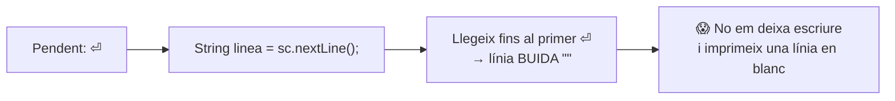
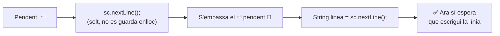

# TuAmigoElScanner — Llegir del teclat amb l'`Scanner`

[🏠 Índex](../../README.md) · [⬅️ Anterior](../VariablesString.md) · [Següent ➡️](../ProblemasIntroJoel/PaAmbTomaquet.md)

Fitxer: `src/elScanner/TuAmigoElScanner.java`

---

## El codi

```java
package elScanner;
//para usar el scanner se tiene que importar
import java.util.Scanner;

public class TuAmigoElScanner {
	
	public static void main(String[] args) {
		
		//Como declarar un Scanner
		//Magia negra, creanme*
		Scanner sc = new Scanner(System.in);
		
		System.out.println("LEER INTS");
		//leer ints
		int a = sc.nextInt(); //lee el siguiente int
		int b = sc.nextInt();
		int c = sc.nextInt();
		
		System.out.println(a+b+c);
		
		System.out.println("------------------------------");
		//leer doubles
		System.out.println("LEER DOUBLES");
		double da = sc.nextDouble();
		double db = sc.nextDouble();
		double dc = sc.nextDouble();
		
		System.out.println(da*db*dc);
		System.out.println("------------------------------");
		//leer Strings
		
		//SI TU LEES NUMEROS Y LUEGO LINEA DE TEXTO, TIENES QUE PONER UN SC.NEXTLINE SUELTO
		sc.nextLine();
		
		
		System.out.println("LEER STRINGS (lineas de texto)");

		String linea = sc.nextLine();
		System.out.println(linea);
		
		
	}

}
```

**Exemple d'execució** (les línies marcades amb `← jo escric això` són les que escric jo amb el teclat, prement `Enter` al final):

```
LEER INTS
1 2 3            ← jo escric això
6
------------------------------
LEER DOUBLES
2 1,5 4          ← jo escric això
12.0
------------------------------
LEER STRINGS (lineas de texto)
Hola que tal     ← jo escric això
Hola que tal
```

---

## 🤔 Per a què serveix

Fins ara els valors de les variables estaven **escrits al codi** (`int a = 0;`). El programa feia sempre el mateix.

Amb l'`Scanner`, el programa **s'espera** que l'usuari escrigui alguna cosa per teclat i la guarda en una variable. Així el mateix programa funciona amb dades diferents cada vegada.



---

## 1️⃣ Importar

```java
package elScanner;
//para usar el scanner se tiene que importar
import java.util.Scanner;
```

- L'`Scanner` no ve "de sèrie": és una eina de la biblioteca de Java, que està guardada a `java.util`.
- L'`import` va **a dalt de tot**, després del `package` i **abans** del `public class`.
- Sense l'`import`, Eclipse subratlla `Scanner` en vermell: *"Scanner cannot be resolved to a type"*.

> [!TIP]
> A Eclipse, `Ctrl + Shift + O` posa sol els `import` que falten.

---

## 2️⃣ Crear l'Scanner

```java
		//Como declarar un Scanner
		//Magia negra, creanme*
		Scanner sc = new Scanner(System.in);
```

És la mateixa fórmula que una variable: `TIPUS NOM_VARIABLE = VALOR_INICIAL;`

| `Scanner` | `sc` | `=` | `new Scanner(System.in)` |
|:-:|:-:|:-:|:-:|
| TIPUS | NOM_VARIABLE | guarda-hi | VALOR_INICIAL: "crea un Scanner nou que llegeixi del teclat" |

- `System.in` = el **teclat** (l'entrada). Igual que `System.out` és la **pantalla** (la sortida).
- `new` = crear un objecte nou. (Ja s'explicarà més endavant — de moment, "magia negra".)
- `sc` és el nom que li he posat; es podria dir de qualsevol manera, però `sc` és el típic.
- **Un sol Scanner per programa** n'hi ha prou. Es crea un cop i es fa servir tantes vegades com calgui.

---

## 3️⃣ Llegir `int`

```java
		System.out.println("LEER INTS");
		//leer ints
		int a = sc.nextInt(); //lee el siguiente int
		int b = sc.nextInt();
		int c = sc.nextInt();
		
		System.out.println(a+b+c);
```

- `sc.nextInt()` → **atura el programa** fins que escric un número enter i premo `Enter`. Aquest número es guarda a la variable.
- Ho faig tres cops → llegeixo tres números (`a`, `b`, `c`).
- `a+b+c` → com que són tres `int`, el `+` **suma**. Si escric `1 2 3` imprimeix `6`.

> [!NOTE]
> Els números es poden escriure **en una línia separats per espais** (`1 2 3` + Enter) **o en línies diferents** (`1` Enter `2` Enter `3` Enter). L'`nextInt()` agafa "el següent número", estigui on estigui.

> [!WARNING]
> Si a un `nextInt()` li escric una cosa que no és un enter (per exemple `hola` o `2.5`), el programa peta amb `InputMismatchException`.

---

## 4️⃣ Llegir `double`

```java
		//leer doubles
		System.out.println("LEER DOUBLES");
		double da = sc.nextDouble();
		double db = sc.nextDouble();
		double dc = sc.nextDouble();
		
		System.out.println(da*db*dc);
```

- Igual que abans, però amb `nextDouble()` i variables `double`.
- `da*db*dc` → multiplica els tres. Amb `2 1,5 4` → `2 × 1.5 × 4 = 12.0`.
- Un `double` sempre s'imprimeix amb decimal: `12.0`, no `12`.

> [!WARNING]
> **Coma o punt?** Depèn de l'idioma de l'ordinador. En un Windows en català/castellà, l'`Scanner` espera **coma**: `1,5`. Si escric `1.5` peta amb `InputMismatchException`.
> Però en **imprimir**, `println` fa servir sempre **punt**: `12.0`.
> I **dins del codi** Java sempre és punt: `double d = 1.5;`

---

## 5️⃣ Llegir text (línies) i el famós `nextLine` solt

```java
		//leer Strings
		
		//SI TU LEES NUMEROS Y LUEGO LINEA DE TEXTO, TIENES QUE PONER UN SC.NEXTLINE SUELTO
		sc.nextLine();
		
		
		System.out.println("LEER STRINGS (lineas de texto)");

		String linea = sc.nextLine();
		System.out.println(linea);
```

- `sc.nextLine()` → llegeix **tota la línia** que escric (amb espais inclosos) fins a l'`Enter`, i la retorna com a `String`.

### Per què cal el `sc.nextLine();` solt?

Quan escric números, en realitat escric el número **i** un `Enter` (`⏎`). Els `nextInt()`/`nextDouble()` s'emporten el número però **deixen l'`Enter` allà**, pendent.

```
Després de llegir els doubles, l'Scanner té pendent:

    2 1,5 4⏎
    ▲ ▲   ▲ ▲
    │ │   │ └── l'Enter: ningú se l'ha endut! 😱
    da db dc
```

**Sense** el `nextLine()` solt:



**Amb** el `nextLine()` solt:



- El `sc.nextLine();` solt llegeix la resta de línia (l'`Enter` sobrant) i **no la guarda enlloc**: només serveix per "netejar".

> [!IMPORTANT]
> Regla: **si llegeixo números (`nextInt`/`nextDouble`) i després vull llegir una línia de text (`nextLine`), poso un `sc.nextLine();` solt entremig.**
> Si només llegeixo línies (com a [Pa amb tomàquet](../ProblemasIntroJoel/PaAmbTomaquet.md)), no cal.

---

## 📋 Taula resum de mètodes

| Vull llegir... | Mètode | Tipus de la variable | Exemple |
|----------------|--------|----------------------|---------|
| Un número enter | `sc.nextInt()` | `int` | `int a = sc.nextInt();` |
| Un número amb decimals | `sc.nextDouble()` | `double` | `double da = sc.nextDouble();` |
| Una línia de text sencera | `sc.nextLine()` | `String` | `String linea = sc.nextLine();` |

> [!TIP]
> El tipus de la variable ha de coincidir amb el mètode: `nextInt` → `int`, `nextDouble` → `double`, `nextLine` → `String`. Si poses `int x = sc.nextLine();`, Eclipse dona error.

---

## ✅ Resum

1. `import java.util.Scanner;` a dalt.
2. `Scanner sc = new Scanner(System.in);` un cop.
3. `sc.nextInt()`, `sc.nextDouble()`, `sc.nextLine()` per llegir.
4. Números → després text: `sc.nextLine();` solt entremig.
5. Decimals pel teclat: amb **coma** (`1,5`) si l'ordinador està en català/castellà.
