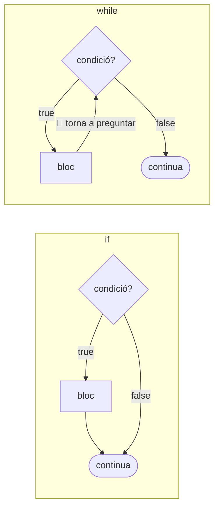
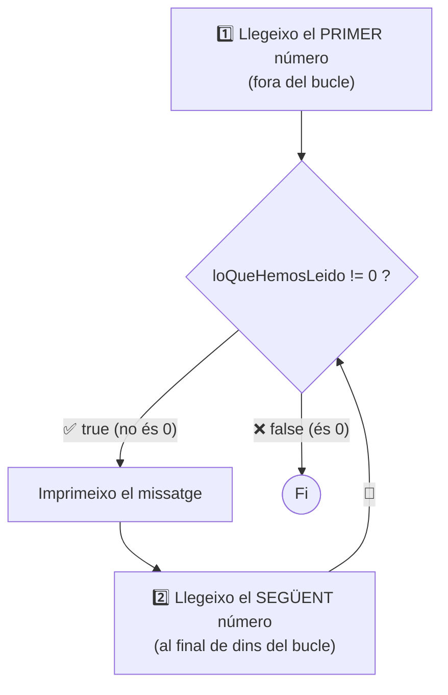

# IntroduccioWhile — El bucle `while`: repetir

[🏠 Índex](../../README.md) · [📦 Paquet](README.md) · [⬅️ Anterior](../alternativesswitch/exempleString.md)

Fitxer: `src/introbucles/IntroduccioWhile.java`

---

## El codi

```java
package introbucles;

import java.util.Scanner;

public class IntroduccioWhile {
	
	
	public static void main(String[] args) {
		
		//nosaltres coneixem un if
		//if(condicio booleana){
		// el que es fa si la condicio es true
		// }
		
		
		//while(condicio booleana){
		//   Es repeteix aixo si la condicio es true
		//}
		
		if(4<5) {
			System.out.println("A");
		}
		
		//while(4<5) {
			//el programa NUNCA llega al final porque se queda atrapado en el bucle
			//eso se llama bucle infinito
			//System.out.println("A");
		//}
		
		//la gracia dels bucles es que la condició canvii
		//es a dir, la condicio es modifica dintre del mateix bucle
		
		int a = 1; //contador
		while(a<10) {
			
			System.out.println(a);
			a++; //a = a+1;
		}
		
		
		//bucle para verificar
		System.out.println("----------------------");
		System.out.println("bucle para verificar");
		Scanner sc = new Scanner(System.in);
		
		//GENERALMENTE CUANDO QUIERES HACER UN BUCLE PARA VERIFICAR LA PRIMERA VEZ LEES FUERA DEL BUCLE
		int loQueHemosLeido = sc.nextInt();
		while(loQueHemosLeido!=0) { //RECORDAD; ES LA CONDICION DE ESTAR DENTRO, NO LA DE SALIR
			
			System.out.println("No hemos leido un 0, hemos leido un "+loQueHemosLeido);
			System.out.println("dime otro numero");
			loQueHemosLeido = sc.nextInt();
		}
		
	}

}
```

**Exemple d'execució** (escric `5`, `-3` i `0`):

```
A
1
2
3
4
5
6
7
8
9
----------------------
bucle para verificar
5                                          ← jo escric això
No hemos leido un 0, hemos leido un 5
dime otro numero
-3                                         ← jo escric això
No hemos leido un 0, hemos leido un -3
dime otro numero
0                                          ← jo escric això (i s'acaba)
```

---

## 🆚 1. `if` vs `while`

```java
		//nosaltres coneixem un if
		//if(condicio booleana){
		// el que es fa si la condicio es true
		// }
		
		
		//while(condicio booleana){
		//   Es repeteix aixo si la condicio es true
		//}
```

S'escriuen **gairebé igual**, només canvia la paraula. Però:

| | `if` | `while` |
|---|------|---------|
| Es llegeix | "**si** ..." | "**mentre** ..." |
| Quantes vegades fa el bloc | **0 o 1** | **0, 1, 2, 3...** tantes com calgui |
| Què fa en acabar el bloc | Continua cap avall | **Torna a dalt** i torna a mirar la condició |



Un **bucle** és un tros de codi que **es repeteix**. El `while` és el primer bucle que veiem.

```java
		if(4<5) {
			System.out.println("A");
		}
```

`4<5` és `true` → imprimeix `A` **una vegada** i continua.

---

## ♾️ 2. El bucle infinit

```java
		//while(4<5) {
			//el programa NUNCA llega al final porque se queda atrapado en el bucle
			//eso se llama bucle infinito
			//System.out.println("A");
		//}
```

*(Està comentat perquè, si no, el programa no acabaria mai.)*

Si canviem `if` per `while` amb la mateixa condició:

1. `4<5`? → `true` → imprimeix `A`.
2. Torna a dalt: `4<5`? → **continua sent `true`** (4 i 5 no canvien mai) → imprimeix `A`.
3. Torna a dalt: `4<5`? → `true` → `A`...
4. ... **per sempre**.

```
A
A
A
A
... (sense parar mai)
```

> [!WARNING]
> Si mai et passa un bucle infinit a Eclipse, atura el programa amb el **quadrat vermell ⏹️** de la consola (*Terminate*).

---

## 🔢 3. El comptador: la condició ha de canviar

```java
		//la gracia dels bucles es que la condició canvii
		//es a dir, la condicio es modifica dintre del mateix bucle
		
		int a = 1; //contador
		while(a<10) {
			
			System.out.println(a);
			a++; //a = a+1;
		}
```

Perquè un bucle s'acabi, **alguna cosa de dins ha de fer canviar la condició**. Aquí és `a++` (suma 1 a `a`, mira [exempleNum](../alternativesswitch/exempleNum.md)): a cada volta `a` creix, i arriba un moment que `a<10` passa a ser `false`.

Les tres peces d'un comptador:

| Peça | Codi | Per a què |
|------|------|-----------|
| **Inici** | `int a = 1;` | Des d'on comença (abans del bucle) |
| **Condició** | `a<10` | Fins quan continua |
| **Canvi** | `a++;` | Com avança a cada volta (dins del bucle) |

### Pas a pas (traça)

| Volta | `a` val | `a<10`? | Què fa | `a` després de `a++` |
|:-----:|:-------:|:-------:|--------|:--------------------:|
| 1 | 1 | ✅ `true` | imprimeix `1` | 2 |
| 2 | 2 | ✅ `true` | imprimeix `2` | 3 |
| 3 | 3 | ✅ `true` | imprimeix `3` | 4 |
| ... | ... | ... | ... | ... |
| 9 | 9 | ✅ `true` | imprimeix `9` | 10 |
| — | 10 | ❌ `false` | **surt del bucle** | — |

Resultat: imprimeix del **1 al 9**. El **10 no surt**, perquè quan `a` val 10 la condició `a<10` ja és `false`.

> [!TIP]
> Si vols que surti també el 10: `while(a<=10)`. Si vols que comenci pel 0: `int a = 0;`.

> [!WARNING]
> Si t'oblides el `a++;`, `a` sempre val 1, `1<10` sempre és `true` → **bucle infinit** imprimint `1`.

> [!NOTE]
> L'ordre de dins el bucle importa. Aquí primer s'imprimeix i després se suma. Si fos al revés (`a++;` i després `println`), sortiria del **2 al 10**.

---

## ✅ 4. El bucle per verificar (llegir fins a un 0)

```java
		//bucle para verificar
		System.out.println("----------------------");
		System.out.println("bucle para verificar");
		Scanner sc = new Scanner(System.in);
		
		//GENERALMENTE CUANDO QUIERES HACER UN BUCLE PARA VERIFICAR LA PRIMERA VEZ LEES FUERA DEL BUCLE
		int loQueHemosLeido = sc.nextInt();
		while(loQueHemosLeido!=0) { //RECORDAD; ES LA CONDICION DE ESTAR DENTRO, NO LA DE SALIR
			
			System.out.println("No hemos leido un 0, hemos leido un "+loQueHemosLeido);
			System.out.println("dime otro numero");
			loQueHemosLeido = sc.nextInt();
		}
```

Ara no sabem **quantes vegades** es repetirà: depèn de l'usuari. El programa va llegint números **fins que escriu un `0`**.

### L'esquema: llegir fora, i llegir al final de dins



```java
		//GENERALMENTE CUANDO QUIERES HACER UN BUCLE PARA VERIFICAR LA PRIMERA VEZ LEES FUERA DEL BUCLE
```

Per què es llegeix **fora** la primera vegada? Perquè la condició `loQueHemosLeido!=0` necessita que la variable **ja tingui un valor** abans de preguntar-ho per primer cop.

I per què es torna a llegir **dins**, al final? Perquè és el que **fa canviar la condició** (com el `a++` del comptador). Sense aquesta línia, el número no canviaria mai → bucle infinit.

### "És la condició d'estar dins, no la de sortir"

```java
		while(loQueHemosLeido!=0) { //RECORDAD; ES LA CONDICION DE ESTAR DENTRO, NO LA DE SALIR
```

Jo penso: *"vull **parar** quan llegeixi un 0"*. Però el `while` no pregunta quan parar, sinó **quan continuar**:

| Penso (sortir) | Escric al `while` (estar dins) |
|----------------|-------------------------------|
| "Para quan sigui **0**" | `while(loQueHemosLeido != 0)` → "continua mentre **no** sigui 0" |
| "Para quan `a` arribi a 10" | `while(a < 10)` → "continua mentre sigui més petit que 10" |

> [!WARNING]
> Error típic: escriure `while(loQueHemosLeido == 0)`. Això vol dir "continua mentre sigui 0" → si escrius un 5, **ni tan sols entra**.

### Traça amb `5`, `-3`, `0`

| Moment | Llegeix | `loQueHemosLeido` | `!= 0`? | Què passa |
|--------|:-------:|:-----------------:|:-------:|-----------|
| Abans del bucle | `5` | 5 | ✅ | entra: `No hemos leido un 0, hemos leido un 5` |
| Final volta 1 | `-3` | -3 | ✅ | torna a entrar: `... hemos leido un -3` |
| Final volta 2 | `0` | 0 | ❌ | **surt**: no imprimeix res més |

> [!NOTE]
> Si el **primer** número que escric ja és `0`, la condició és `false` des del principi i **no entra cap vegada** al bucle. Un `while` es pot executar 0 vegades.

---

## ✅ Resum

- `while(condició) { ... }` → repeteix el bloc **mentre** la condició sigui `true`.
- Si la condició no canvia mai → **bucle infinit**.
- Comptador: **inici** (`int a = 1;`) + **condició** (`a<10`) + **canvi** (`a++`).
- Bucle per verificar: **llegir fora** abans + **llegir dins** al final.
- La condició és la d'**estar dins**, no la de sortir.
