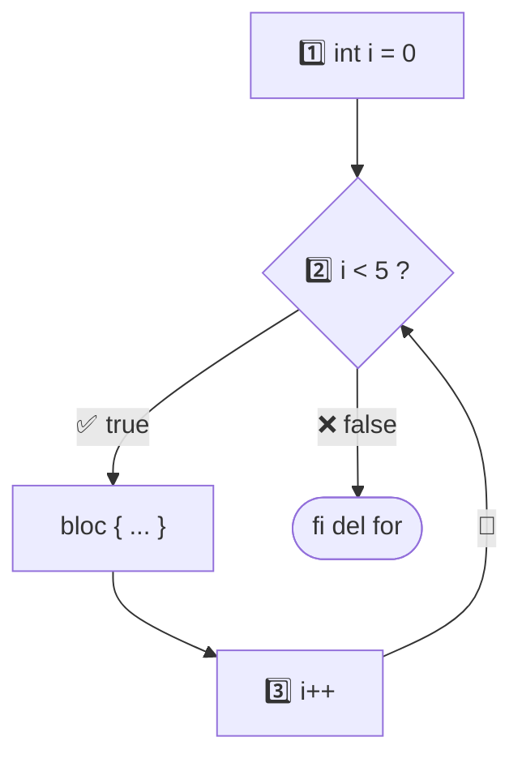

# introduccioFor — El bucle `for`: comptar d'un inici a un final

[🏠 Índex](../../README.md) · [📦 Paquet](README.md) · [⬅️ Anterior](IntroduccioWhile.md)

Fitxer: `src/introbucles/introduccioFor.java`

> [!NOTE]
> Què és un bucle i com funciona el `while` està explicat a [IntroduccioWhile](IntroduccioWhile.md). El `for` és un `while` amb comptador "empaquetat" en una sola línia.

---

## El codi

```java
package introbucles;

import java.util.Scanner;

public class introduccioFor {
	
	public static void main(String[] args) {
		
		//bucle for
		
		//es un bucle que sirve para hacer una cosa en concreto
		//que es cuando sabes donde esta el inicio y donde esta el final
		
		//i es el contador, se llama siempre i por convenio
		//for(int i = VALOR_INICIAL; CONDICION DE MANTENERSE (que casi siempre sera i< VALOR FINAL) ; Incremento (que casi siempre sera i++)){
		
		System.out.println("For de inicio a fin");
		for(int i=0;i<5;i++) { //compta de 0 a 5
			System.out.println("A");
		}
		
		for(int i=0;i<5;i++) { //compta de 0 a 5
			System.out.println(i);  //la i no només serveix per comptar, es pot utilitzar!
		}
		
		System.out.println("El final es indeterminado");
		
		Scanner sc = new Scanner(System.in);
		int fin = sc.nextInt();
		
		for(int i=0;i<fin;i++) { //compta de 0 a fin, no sabem que es fin,pero sabem que entrara per teclat i es una variable
			System.out.println(i);
		}
		System.out.println("-----------");
		for(int i=0;i<fin;i++) { //compta de 0 a fin...
			System.out.println(fin-i); //pero aqui sortirà al reves
		}
		
		System.out.println("el inicio es indetermiando");
		
		int inicio = sc.nextInt();
		
		for(int i = inicio; i<10;i++) {  //compta de inicio a 10, inicio vindra per teclat
			System.out.println(i);
		}
		
		
		System.out.println("PERO OJO QUE PODEMOS CONTAR HACIA ATRAS");
		inicio = sc.nextInt();
		
		for(int i = inicio;i>=0;i--) {
			System.out.println(i);
		}
		
		System.out.println("Y DE FORMAS RARAS TAMBIEN");
		for(int i=0;i<10;i=i+2) {
			System.out.println(i);
		}
		System.out.println("-----------");
		for(int i=1;i<100;i=i+i) {
			System.out.println(i);
		}
		System.out.println("-----------");
		for(int i=1;i<100;i=i*2) {
			System.out.println(i);
		}
		System.out.println("-----------");
		for(int i=2;i<1000;i=i*i) {
			System.out.println(i);
		}
		
		
	}

}
```

**Exemple d'execució** (escric tres números: `4`, `7` i `3`):

| Tros | Sortida |
|------|---------|
| For de inicio a fin | `A` `A` `A` `A` `A` i després `0` `1` `2` `3` `4` |
| Final indeterminat (`fin = 4`) | `0` `1` `2` `3` / `-----------` / `4` `3` `2` `1` |
| Inici indeterminat (`inicio = 7`) | `7` `8` `9` |
| Cap enrere (`inicio = 3`) | `3` `2` `1` `0` |
| `i=i+2` | `0` `2` `4` `6` `8` |
| `i=i+i` | `1` `2` `4` `8` `16` `32` `64` |
| `i=i*2` | `1` `2` `4` `8` `16` `32` `64` |
| `i=i*i` | `2` `4` `16` `256` |

*(A la consola cada número surt en una línia diferent, i entremig surten els títols `For de inicio a fin`, `El final es indeterminado`... i les ratlles `-----------`.)*

---

## 🧩 1. L'estructura del `for`

```java
		//es un bucle que sirve para hacer una cosa en concreto
		//que es cuando sabes donde esta el inicio y donde esta el final
		
		//i es el contador, se llama siempre i por convenio
		//for(int i = VALOR_INICIAL; CONDICION DE MANTENERSE (que casi siempre sera i< VALOR FINAL) ; Incremento (que casi siempre sera i++)){
```

Recordes les **tres peces del comptador** del [while](IntroduccioWhile.md)? (inici, condició i canvi). El `for` les posa **totes tres a la mateixa línia**, separades per **punt i coma** `;`:

```
   for ( int i = 0 ;   i < 5   ;   i++ ) {
         ─────┬────    ───┬──      ─┬─
              │           │         │
        1️⃣ INICI     2️⃣ CONDICIÓ   3️⃣ INCREMENT
        (un cop,     (abans de     (al final de
        al principi)  cada volta)   cada volta)
   }
```

| Peça | Al codi | Quan es fa |
|------|---------|-----------|
| 1️⃣ **VALOR_INICIAL** | `int i=0` | **Una sola vegada**, abans de començar |
| 2️⃣ **CONDICIÓ DE MANTENIR-SE** | `i<5` | **Abans de cada volta**. Si és `false`, surt |
| 3️⃣ **INCREMENT** | `i++` | **Al final de cada volta**, després del bloc |



### `for` i `while` fan el mateix

Amb `for`:

```java
for(int i=0;i<5;i++) {
	System.out.println(i);
}
```

Amb `while` (el mateix, però amb les tres peces en llocs diferents):

```java
int i = 0;                     // 1️⃣ inici
while(i<5) {                   // 2️⃣ condició
	System.out.println(i);
	i++;                       // 3️⃣ increment
}
```

| Fes servir... | Quan... |
|---------------|---------|
| `for` | **Saps on comença i on acaba** (de 0 a 5, de 0 a `fin`...) |
| `while` | **No saps quantes voltes** farà (llegir fins que escrigui un 0) |

> [!WARNING]
> - Dins dels parèntesis del `for` les peces se separen amb **`;`**, no amb comes.
> - **No** es posa `;` després del `)`: `for(...);{` faria un bucle buit.

> [!NOTE]
> "Es diu sempre `i` per conveni": la `i` ve de *índex*. Pots posar-li qualsevol nom, però tothom fa servir `i`.

---

## 🔁 2. Repetir una cosa N vegades

```java
		System.out.println("For de inicio a fin");
		for(int i=0;i<5;i++) { //compta de 0 a 5
			System.out.println("A");
		}
```

Imprimeix `A` **5 vegades**. La `i` només serveix per comptar les voltes.

| Volta | `i` | `i<5`? | Imprimeix |
|:-----:|:---:|:------:|:---------:|
| 1 | 0 | ✅ | `A` |
| 2 | 1 | ✅ | `A` |
| 3 | 2 | ✅ | `A` |
| 4 | 3 | ✅ | `A` |
| 5 | 4 | ✅ | `A` |
| — | 5 | ❌ | *(surt)* |

> [!NOTE]
> El comentari diu "compta de 0 a 5", però la `i` val **0, 1, 2, 3 i 4**. El **5 no hi entra**, perquè `5<5` és `false`. Fa **5 voltes**, però l'últim valor és **4**.
>
> 💡 Truc: `for(int i=0; i<N; i++)` fa **exactament N voltes**, de `0` a `N-1`.

---

## 🔢 3. Fer servir la `i`

```java
		for(int i=0;i<5;i++) { //compta de 0 a 5
			System.out.println(i);  //la i no només serveix per comptar, es pot utilitzar!
		}
```

Ara s'imprimeix **la `i` mateixa** → `0` `1` `2` `3` `4`. La `i` és una variable `int` normal: la pots imprimir, sumar, multiplicar...

> [!NOTE]
> Aquí es torna a escriure `int i` i **no dona error de "Duplicate variable"**. La `i` d'un `for` **només existeix dins d'aquell `for`**: quan s'acaba el bucle, desapareix. Per això cada `for` pot tenir la seva pròpia `i`.
>
> I per la mateixa raó, **fora** del `for` no la pots fer servir: `System.out.println(i);` després del bucle dona error.

---

## ⌨️ 4. El final ve del teclat

```java
		System.out.println("El final es indeterminado");
		
		Scanner sc = new Scanner(System.in);
		int fin = sc.nextInt();
		
		for(int i=0;i<fin;i++) { //compta de 0 a fin, no sabem que es fin,pero sabem que entrara per teclat i es una variable
			System.out.println(i);
		}
```

Quan escric el codi **no sé** quant valdrà `fin`, però no passa res: la condició `i<fin` fa servir el valor que l'usuari hagi escrit.

| `fin` | Imprimeix |
|:-----:|-----------|
| `4` | `0` `1` `2` `3` |
| `1` | `0` |
| `0` | *(res: `0<0` és `false` des del principi)* |

### Al revés: `fin-i`

```java
		System.out.println("-----------");
		for(int i=0;i<fin;i++) { //compta de 0 a fin...
			System.out.println(fin-i); //pero aqui sortirà al reves
		}
```

La `i` continua anant cap endavant (`0, 1, 2, 3`), però el que **s'imprimeix** és `fin-i`:

| `i` | `fin-i` (amb `fin = 4`) |
|:---:|:-----------------------:|
| 0 | 4 - 0 = **4** |
| 1 | 4 - 1 = **3** |
| 2 | 4 - 2 = **2** |
| 3 | 4 - 3 = **1** |

Resultat: `4` `3` `2` `1`. Va **del `fin` a l'1** (no surt el 0).

---

## ⌨️ 5. L'inici ve del teclat

```java
		System.out.println("el inicio es indetermiando");
		
		int inicio = sc.nextInt();
		
		for(int i = inicio; i<10;i++) {  //compta de inicio a 10, inicio vindra per teclat
			System.out.println(i);
		}
```

Ara és l'**inici** el que no sabem. La `i` comença on digui l'usuari i arriba fins a **9**.

| `inicio` | Imprimeix |
|:--------:|-----------|
| `7` | `7` `8` `9` |
| `0` | `0` `1` ... `9` |
| `10` o més | *(res)* |

---

## ⬇️ 6. Comptar cap enrere

```java
		System.out.println("PERO OJO QUE PODEMOS CONTAR HACIA ATRAS");
		inicio = sc.nextInt();
		
		for(int i = inicio;i>=0;i--) {
			System.out.println(i);
		}
```

- `inicio = sc.nextInt();` → **sense `int`** davant, perquè `inicio` ja existeix (mira [VariablesInt](../VariablesInt.md)). Només li canvio el valor.
- Per anar cap enrere canvien **dues** coses:

| | Cap endavant | Cap enrere |
|---|---|---|
| Condició | `i < final` | `i >= 0` (mentre no passi de 0) |
| Increment | `i++` (suma 1) | `i--` (**resta 1**) |

Amb `inicio = 3`: `3` `2` `1` `0`. El `0` **sí** que surt, perquè la condició és `>=`.

> [!WARNING]
> Si per error poses `i++` en un bucle que va cap enrere (`for(int i = 3; i>=0; i++)`), la `i` creix: 3, 4, 5... i `i>=0` **sempre** és `true` → **bucle infinit**.

---

## 🌀 7. "Y de formas raras también": increments diferents

L'increment **no ha de ser sempre `i++`**. Pot ser qualsevol operació que canviï la `i`.

### De 2 en 2

```java
		for(int i=0;i<10;i=i+2) {
			System.out.println(i);
		}
```

`0` `2` `4` `6` `8` → els **parells** fins a 10.

### Doblant: `i=i+i` i `i=i*2`

```java
		for(int i=1;i<100;i=i+i) {
			System.out.println(i);
		}
```

```java
		for(int i=1;i<100;i=i*2) {
			System.out.println(i);
		}
```

Tots dos imprimeixen el mateix: `1` `2` `4` `8` `16` `32` `64`. Sumar un número amb ell mateix (`i+i`) és el mateix que multiplicar-lo per 2 (`i*2`).

| `i` | `i+i` = `i*2` | `< 100`? |
|:---:|:-------------:|:--------:|
| 1 | 2 | ✅ |
| 2 | 4 | ✅ |
| 4 | 8 | ✅ |
| ... | ... | ... |
| 64 | 128 | ❌ → surt |

> [!WARNING]
> Per això aquests bucles comencen amb `i=1` i no amb `i=0`. Amb `i=0`: `0*2 = 0`, `0+0 = 0`... la `i` **no creix mai** → **bucle infinit**.

### Elevant al quadrat: `i=i*i`

```java
		for(int i=2;i<1000;i=i*i) {
			System.out.println(i);
		}
```

| `i` | `i*i` |
|:---:|:-----:|
| **2** | 4 |
| **4** | 16 |
| **16** | 256 |
| **256** | 65536 → ja no és `< 1000`, surt |

Resultat: `2` `4` `16` `256`. Creix **molt** ràpid.

> [!NOTE]
> Aquí també comença amb `i=2` per una raó: amb `i=1`, `1*1 = 1` per sempre → bucle infinit. I amb `i=0`, igual.

---

> [!NOTE]
> Per conveni, els noms de classe en Java comencen amb **majúscula** (`IntroduccioFor`, com `IntroduccioWhile`). `introduccioFor` funciona igual.

## ✅ Resum

- `for(int i = INICI; CONDICIÓ; INCREMENT) { ... }` → les 3 peces del comptador en una línia, separades per `;`.
- Fes servir `for` quan **saps l'inici i el final**, i `while` quan no saps quantes voltes farà.
- `for(int i=0; i<N; i++)` → **N voltes**, de `0` a `N-1`.
- La `i` es pot imprimir i fer servir en càlculs (`fin-i`).
- L'inici i el final poden ser variables (per exemple, llegides del teclat).
- Cap enrere: `i>=0` i `i--`.
- L'increment pot ser qualsevol cosa (`i=i+2`, `i=i*2`...), però **ha de fer que la `i` arribi a complir la condició de sortida**.
